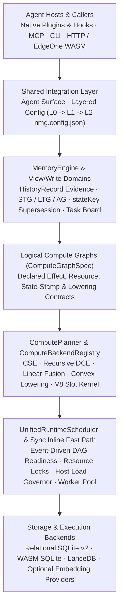
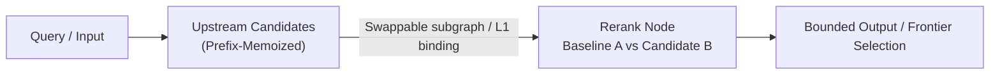

# Node Memory Graph (NMG)

English | [简体中文](README.zh-CN.md) · [Terms](README.terms.yaml)

*Memory is part of intelligence.*

NMG is a local-first, extensible **memory infrastructure** for AI agents:

- **For agent workflows:** persistent cross-session, cross-host memory in local SQLite (`LTG`, `STG`, and `Task Board`). Give your agent the [setup prompt](#connect-your-agent) to build, wire, and verify it from source (Node.js 22.19+).
- **For builders and researchers:** a composable compute-graph (`ComputeGraphSpec`), layered configuration, and adaptive runtime substrate for developing, benchmarking, and deploying memory algorithms without rewriting storage.

Core memory operations run with **zero external LLM calls**, without locking you into a specific model, agent host, or storage backend. Lexical and graph recall work offline; optional local or remote embeddings add hybrid semantic recall.

[Try it](#try-it) · [Why NMG?](#why-nmg) · [Architecture](#architecture) · [Build with NMG](#build-with-nmg) · [Evaluation](#evaluation-and-engineering) · [Integrations](#integrations)

## Try it

You need **Node.js 22.19 or newer** and a local checkout of this repository. NMG runs natively on Windows, macOS, and Linux via built-in `node:sqlite` over local SQLite files—no Docker, separate graph/vector database server, or Python/C++ toolchain is required. From the checkout root:

```sh
npm ci
npm run tutorial:first-recall
```

The tutorial creates a temporary private SQLite database, remembers one scoped record, searches for candidates, and opens exact evidence before cleaning up on exit. It does not call an LLM or embedding service or touch your regular NMG store. Use `npm run tutorial:first-recall -- --non-interactive` in non-interactive shells; see [first recall walkthrough](docs/guides/first-recall.md).

What the evidence-grounded memory loop looks like:

```text
Remember (state/constraint):  API auth uses short-lived tokens; session cookies are deprecated.
Search   (compact leads):     How should new endpoints authenticate? -> [candidate header + activeGraphId]
Get      (exact evidence):    Opens the selected MemoryRecord, supersession state, and HistoryRecord source.
```

Search headers are compact routing leads, not proof. Passing `activeGraphId` into `get` opens lossless source evidence and preserves disclosure attribution.

### Connect your agent

Send this prompt to your agent and let it configure NMG for its host environment:

```text
Please install and connect Node Memory Graph (NMG) for me:
https://github.com/wefio/NodeMemoryGraph

First identify your current agent host, operating system, and existing setup.
Use an existing persistent checkout if available; otherwise clone the repo to
a suitable persistent directory. Read the repository README, the relevant
adapter instructions, and skills/nmg-memory/SKILL.md. Choose the best supported
integration for this environment.

Install the required dependencies, build, and configure the integration while
preserving existing settings and data. Use a native adapter or MCP when
supported; otherwise use the CLI and Skill. Do not overwrite existing
configuration or stop or restart a shared daemon that this setup did not start.

Verify the memory loop with the repository's temporary-store tutorial, then
check whether the current host can discover or call the configured tools.
Report the install location, enabled capabilities, verification results, and
any restart or action I need to complete. Do not treat a passing tutorial as
proof that the host integration works.
```

## Why NMG?

| Principle | Implemented capability | Contract owner |
| --- | --- | --- |
| **Zero-LLM deterministic baseline + optional embeddings** | SQLite FTS5/trigram recall, BM25F, temporal/turn/concept-graph reranking, and `stateKey` supersession run offline with zero LLM calls; pairing local 384-d embeddings (`BGE-small-en-v1.5`) or external providers adds 3:1 hybrid semantic fusion | [Unified architecture](docs/design/unified-architecture.md) |
| **Evidence-grounded & state-aware** | Keeps raw `HistoryRecord` provenance separate from scoped `MemoryRecord` claims across `STG`, `LTG`, and session `Active Graph (AG)`, with `stateKey` supersession and validity windows | [Core design](docs/design/design.md) |
| **Agent-oriented feedback loops** | Returns budgeted `search` directories (`activeGraphId`) before lossless `get`, named protocol refusals on `state`/`board`, persistent `rpcRejections` diagnostics (`nmg status --json`), and `<15 KB` CI-verified docs (`AGENTS.md`, `agent:verify`) for coding agents | [Documentation governance](docs/design/documentation-governance.md) |
| **Composable graphs & backend delegation** | Retrieval, reranking, projection, and write planning execute via `ComputeGraphSpec` + `L0 -> L1 -> L2` config; `ComputeBackendRegistry` pushes convex relational regions to SQLite, compiles lock-free sync DAGs to V8 slot closures, and schedules async work via `UnifiedRuntimeScheduler` | [Compute engine](docs/design/unified-architecture/compute-engine.md) |
| **Manifest-assembled tools + reproducible ablations** | Shared `Agent Surface` and tool schemas assemble declaratively from JSON capability manifests while multi-graph prefix caching (`runSyncGraphExperiments`, `findParetoOptimalGraphs`) keeps retrieval ablations reproducible | [Adapter assembly](docs/design/unified-architecture/adapter-capability-assembly.md) |

## Architecture



- **Two complementary graphs:**
  - **Memory Graph (data model):** stores semantic nodes (`MemoryNode`), explicit node and memory edges, temporal/logical chains (`nmg chain`), multi-dimensional pivot views (`projectGraph`), and temporal/state validity (`eventTime`, `createdAt`, `validFrom`–`validUntil`, `stateKey` + `supersedesId`) in single-file relational SQLite with zero per-write LLM requirement.
  - **Compute Graph (`ComputeGraphSpec`, execution model):** models retrieval, reranking, projection, and write pipelines as composable operator DAGs that can be swapped, benchmarked, and lowered to SQLite pushdowns or V8 slot kernels.
- **Default locations & semantic isolation:** `~/.nmg/nmg.sqlite` (`NMG_DATA_DIR` overrides) holds durable memory (`LTG`) and `Task Board`; `<project>/.nmg/stg.sqlite` holds project-local provisional memory (`STG`); `NMG_CONFIG_PATH` or `<dataDir>/nmg.config.json` holds shared `L1` overrides ([runtime options](docs/design/hidden-features-registry/feature-register/runtime-config-and-profiles.md)). Facts, preferences, constraints, states, and events carry explicit types and scopes.
- **Data & daemon operations at a glance:** Inspect health and rejected RPC counts with `npm run cli -- status --json`; reload or restart the local daemon with `npm run cli -- daemon restart`; back up by copying the `.sqlite` files or running `npm run cli -- memory export --json`.

## Build with NMG

You can customize NMG at three layers without rewriting SQLite tables or host adapters:

1. **Swap bindings or runtime policy in shared L1 config** (`<dataDir>/nmg.config.json`, hot-observed by daemon RPC and shared by adapters).
2. **Compose or swap compute nodes, subgraphs, and backend adapters** (`ComputeRegistry`, `ComputeBackendRegistry`, `replaceGraphNode`) and measure them side by side with prefix memoization (`runSyncGraphExperiments`, `runGraphExperiments`, `findParetoOptimalGraphs`).
3. **Embed directly via Node/TypeScript** using `MemoryEngine`, `openMemoryBackend`, and `HttpMemoryService` (`src/index.ts`).



Minimal runnable example swapping a rerank node and sharing upstream execution via `node --experimental-strip-types`:

```ts
import {
  ComputeRegistry,
  INPUT_NODE_ID,
  replaceGraphNode,
  runSyncGraphExperiments,
} from "./src/core/compute-graph.ts";

const registry = new ComputeRegistry()
  .register("candidates", () => [{ id: "m1", score: 0.72 }, { id: "m2", score: 0.85 }], {
    effect: "pure",
  })
  .register(
    "rerank_a",
    ({ default: rows }) =>
      [...(rows as Array<{ id: string; score: number }>)].sort((a, b) => b.score - a.score),
    { effect: "pure" },
  )
  .register(
    "rerank_b",
    ({ default: rows }) =>
      [...(rows as Array<{ id: string; score: number }>)].sort((a, b) => a.score - b.score),
    { effect: "pure" },
  );

const baseline = {
  id: "search-baseline",
  nodes: [
    { id: "fetch", op: "candidates" },
    { id: "rank", op: "rerank_a" },
  ],
  edges: [
    { from: INPUT_NODE_ID, to: "fetch" },
    { from: "fetch", to: "rank" },
  ],
  output: "rank",
};
const variant = replaceGraphNode(baseline, "rank", { op: "rerank_b" }, "search-variant");
const outcome = runSyncGraphExperiments([baseline, variant], registry, "query", {});
// outcome.cacheHits === 1 (upstream "fetch" executes once across both graphs)
```

Shared `L1` configuration example (`nmg.config.json`):

```json
{
  "runtime": { "profile": "balanced" },
  "optimization": { "backend": "auto", "enableRegionLowering": true, "enableSyncKernel": true }
}
```

## Evaluation and engineering

NMG tracks correctness, runtime efficiency, and retrieval quality across reproducible benchmarks:

| Dimension | Measured result | Workload & source |
| --- | --- | --- |
| **Correctness** | Canonical SHA-256 output parity across SQLite pushdown, portable scan, and `LanceMemoryBackend` over `N = 50..2500`, `+08:00` UTC visibility bounds, and concurrent snapshot isolation | Single-host SQLite & embedded LanceDB corpus ([Backend delegation benchmark](docs/experiments/runtime/backend-optimization-delegation-2026-11-26.md)) |
| **Efficiency (Backend lowering)** | At `N = 2500`, SQLite `projectGraph` p50 `4.223 ms` (`0` JS-scanned entities) vs `49.932 ms` portable (`2640` entities); `lexicalSearch` p50 `10.777 ms` vs `18.074 ms`; selective `5%` `userProfile` stays on fast `1.979 ms` portable scan under cost-ratio gating | Multi-scale SQLite vs portable benchmark ([Backend delegation benchmark](docs/experiments/runtime/backend-optimization-delegation-2026-11-26.md)) |
| **Efficiency (Scheduler & workers)** | Asymmetric DAG median `76.0–88.1 ms` vs `121.2–123.2 ms` wave barrier; mixed foreground P99 `15.2–15.5 ms` vs `22.7–34.3 ms`; 4-worker synthetic CPU `334.776` vs `94.125` tasks/s (matched 8-concurrent hybrid runs vary `-1.5%` to `-22.9%` by run order) | Same-host PR #190 matched & synthetic suites ([Unified runtime benchmark](docs/experiments/runtime/unified-runtime-convergence-2026-11-25.md)) |
| **Retrieval quality & packing (Nov 2026)** | Over 1,867 queries (`LoCoMo`, `BEAM`, `LongMemEval`) with SQLite BM25 + local 384-d `BGE-small-en-v1.5` (`0 LLM` calls): 3:1 log-odds fusion reaches **`58.46%` Overall Recall@20** (`58.82%` reachable at `5,500` chars) and **`82.69%` Recall@100** (`70.35%` BEAM@100); knapsack packing (`k=40, floor=400, α=0.5`) reaches **`81.0% / 38.5% / 97.7%`** at `16,000` chars; 5-benchmark (`2,639` queries) piecewise rank-band LODO passes `5/5` | Frozen multi-benchmark replay ([Log-odds fusion](docs/experiments/retrieval/local-log-odds-fusion-2026-11-20.md) · [Knapsack Pareto](docs/experiments/retrieval/fulltext-knapsack-pareto-2026-11-20.md) · [Explicit budget](docs/experiments/retrieval/explicit-search-budget-2026-11-21.md) · [Rank-band LODO](docs/decisions/implemented/2026-11-25-advantage-band-chrono-and-deep-tail-recall.md) · [Eval guide](evals/README.md)) |

## Integrations

| Environment | Capabilities | Integration notes |
| --- | --- | --- |
| [Pi](skills/nmg-memory/references/adapter-usage.md) | Save/search memory, `nmg_get`, automatic recall, working state, Task Board, optional Lab | Build + `pi install ./` from checkout root |
| [OpenCode v2](opencode-plugin/README.md) | Memory tools, automatic recall, working state, and Task Board | Plugin integration with first-turn native scope lookup |
| [Claude Code / MCP](claude-plugins/nmg-memory/CLAUDE.md#adding-to-any-mcp-client) | Memory tools, working state, Task Board, and optional Lab | Local `.mcp.json` server for explicit tool calls |
| [DeepSeek Harness](dsh/dsh-nmg/README.md) | Memory tools, automatic recall, working state, and Task Board | Uses current host plugin package |
| [Codex](codex-plugin/README.md) | Self-contained plugin with multi-session mapping, five tools, and shared hooks | Build/install generated package and trust hooks |
| [Magpie](magpie-plugin/README.md) | Gateway recall, shared tools, memory stats, and embedding index management | Build/install in Magpie connected to daemon |
| [WorkBuddy](workbuddy-plugin/README.md) | Hook-based automatic recall; combinable with MCP tools and Skill | Pairs recall hook with MCP memory tools |
| [Kimi Code CLI](kimi-plugin/README.md) | MCP tools plus optional reminders, presence, and prompt-time board polling | Combines MCP tools with optional prompt hooks |
| Other tool-capable agents | [CLI + Skill](#cli-skill-and-http--wasm-runtime) | Agent executes CLI commands via `SKILL.md` |

Adapters assemble shared tool schemas and **Agent Surface** behavior (compact directory headers, lossless `get`, follow-up writes, Task Board rendering, redaction, and chain projection) from declarative JSON capability manifests ([`adapter-capability-assembly`](docs/design/unified-architecture/adapter-capability-assembly.md)) while binding each host's native lifecycle and transport. Further host details live in the [harness capability matrix](docs/design/harness-capability-matrix.md) and [adapter usage guide](skills/nmg-memory/references/adapter-usage.md).

### CLI, Skill, and HTTP / WASM runtime

- **Standalone CLI:** Run `npm run cli -- <command>` in a checkout (or `nmg <command>` when installed) for `status`, `remember`, `search --compact-json`, `get`, `board`, `chain`, and interactive HTML graph export (`npm run cli -- graph --out memory-graph.html`). Run `npm run cli -- <command> --help` for full flags.
- **Agent Skill:** Link [skills/nmg-memory/SKILL.md](skills/nmg-memory/SKILL.md) into a generic agent's skills directory for CLI-plus-Skill workflows.
- **HTTP & Edge / WASM SQLite:** Start a local HTTP memory service with `nmg http --config ./nmg-http.json` (`/health`, `/add`, `/search`), or deploy stateless request-scoped WASM SQLite workers via [Onlion](onlion/README.md).
- **Development helpers:** Headless Pi inspection/eval helpers (`npm run pi:state`, `npm run pi:prompt`) and QPP controls are documented in [controller design](docs/design/retrieval-confidence-controller/confidence-and-trigger-design.md#caller-specific-activation) and [optional capabilities](skills/nmg-memory/references/optional-capabilities.md).

## Security boundary

Your SQLite database stays on your machine. If you configure an external embedding provider, text selected for embedding is sent to that provider ([embedding configuration](skills/nmg-memory/references/embedding.md)). NMG is a memory component, not an agent or a model: integrations require setup, NMG does not guarantee that an agent will save or recall every detail or that a remembered claim is true, and it does not sandbox agent execution—configure your host permissions separately.

## Development and documentation

- **Verification gate:** `npm run agent:verify` selects and runs the required static checks and test routes against `.nmg/verification/latest.json` (see [repository bootstrap](AGENTS.md)).
- **Start reading:** [Concept map](docs/guides/concept-map.md) · [Documentation index](docs/README.md) · [System design](docs/design/design.md) · [Unified architecture](docs/design/unified-architecture.md) · [License](LICENSE)
