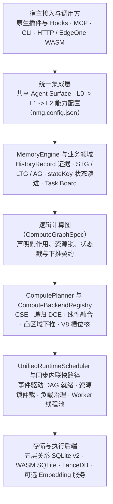
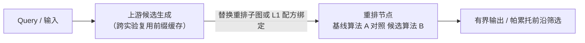

# Node Memory Graph（NMG）

[English](README.md) | 简体中文 · [术语](README.terms.yaml)

*记忆是智能的一部分。*

NMG 是面向 AI Agent 的本地优先、可扩展**记忆基础设施（Memory Infrastructure）**：

- **面向日常 Agent 使用**：在本机 SQLite 中持久维护跨会话、跨工具记忆（`LTG`、`STG` 与 `Task Board`）。基于源码检出运行（Node.js 22.19+）——把[接入提示词](#连接你的-agent)发给你的 Agent，即可由它自动完成构建、配置与自检。
- **面向开发者与研究者**：提供声明式记忆契约、可组合计算图（`ComputeGraphSpec`）、分级配置与自适应运行时，可在同一套存储与数据上低成本替换、压测和复现记忆算法。

核心记忆链路在 **0 次外部 LLM 调用**下即可运行，不绑定特定基模、宿主框架或单一存储后端；离线词法与图重排开箱可用，按需接入本地或外部 Embedding 即可开启混合语义召回。

[快速开始](#快速开始) · [为什么选择 NMG？](#为什么选择-nmg) · [系统架构](#系统架构) · [基于 NMG 构建与扩展](#基于-nmg-构建与扩展) · [评测与工程表现](#评测与工程表现) · [宿主接入](#宿主接入与部署方式)

## 快速开始

环境要求 **Node.js 22.19 或更新版本**与本地仓库检出。NMG 基于 Node 内置 `node:sqlite` 直接读写本地 SQLite 单文件，可在 Windows、macOS 与 Linux 原生运行——无需安装 Docker、独立图／向量数据库服务或 Python／C++ 编译环境。在仓库根目录运行：

```sh
npm ci
npm run tutorial:first-recall
```

教程会新建私有临时 SQLite 库，保存一条带作用域的记忆、检索候选目录并展开精确证据，退出时自动清理。该流程不调用任何 LLM 或 Embedding 服务，也不会改动现有记忆库；非交互终端可加 `--non-interactive`，完整流程说明见[第一次回忆教程](docs/guides/first-recall.zh-CN.md)。

证据驱动的两段式回忆闭环示意：

```text
Remember（写入状态／约束）：API 鉴权采用短生命周期 Token；不再使用 Session Cookie。
Search  （返回紧凑线索）：新接口应该如何鉴权？ -> [候选摘要 + activeGraphId]
Get     （展开原始证据）：按选中 ID 读取完整 MemoryRecord、版本覆盖状态与 HistoryRecord 原文来源。
```

搜索返回的候选目录是精简路由线索，不是最终证明。将 `activeGraphId` 传入 `get` 才会按预算展开无损证据并保留披露归因。

### 连接你的 Agent

将下面这段提示词发给正在使用的 Agent，让它按当前宿主环境自动接入 NMG：

```text
请帮我安装并接入 Node Memory Graph（NMG）：
https://github.com/wefio/NodeMemoryGraph

先识别你当前使用的 Agent、操作系统和已有配置。使用已有的持久仓库检出；
如果没有，请克隆到合适的持久目录。阅读仓库 README、对应适配器说明和
skills/nmg-memory/SKILL.md，再选择当前环境支持的最佳接入方式。

请完成必要的依赖安装、构建和配置，保留已有配置与数据。能使用原生
适配器或 MCP 时按对应说明接入；否则使用 CLI 加 Skill。不要覆盖已有
配置，也不要停止或重启不属于本次安装的共享 daemon。

完成后请验证：先用仓库的临时库教程检查记忆闭环，再检查当前宿主能否
发现或调用所配置的工具。明确告诉我安装位置、启用的能力、验证结果，
以及是否需要重启或由我完成某一步。不要把教程通过当作宿主接入已验证。
```

## 为什么选择 NMG？

| 设计原则 | 对应工程能力 | 契约归属 |
| --- | --- | --- |
| **零 LLM 离线基线 + 按需向量融合** | SQLite FTS5／三元组、BM25F、时序／轮次／概念图重排与 `stateKey` 状态覆盖可在无 LLM 下确定性运行；接入本地 384 维向量（`BGE-small-en-v1.5`）或外部服务即可开启 3:1 对数几率混合召回 | [统一架构](docs/design/unified-architecture.zh-CN.md) |
| **基于证据与状态演进** | 严格区分原始证据 `HistoryRecord` 与带作用域陈述 `MemoryRecord`，跨 `STG`、`LTG` 与会话工作图 `AG` 维护 `stateKey` 覆盖与有效时间窗 | [设计基线](docs/design/design.zh-CN.md) |
| **面向 Agent 的反馈闭环** | 运行时通过有预算的 `search` 目录与 `activeGraphId` 引导 `get` 展开、`state`/`board` 命名拒绝协议及 `rpcRejections` 持久化诊断（`nmg status --json`）；仓库侧提供 `<15 KB` 分片阅读单元（`AGENTS.md`、`agent:verify`）配合编码 Agent 迭代 | [文档治理](docs/design/documentation-governance.zh-CN.md) |
| **可组合计算图与后端委托** | 搜索、重排、投影和写入规划运行在 `ComputeGraphSpec` 与 `L0 -> L1 -> L2` 配置之上；`ComputeBackendRegistry` 下推凸关系区域至 SQLite 并编译 V8 槽位核，`UnifiedRuntimeScheduler` 统筹资源锁与主机负载预算 | [统一计算引擎](docs/design/unified-architecture/compute-engine.zh-CN.md) |
| **声明式能力装配 + 可复现实验** | 公共 `Agent Surface` 与工具 schema 通过 JSON 能力清单声明式勾选装配，配合前缀缓存的多图对比（`runSyncGraphExperiments`、`findParetoOptimalGraphs`）支持低成本消融实验 | [声明式适配器装配](docs/design/unified-architecture/adapter-capability-assembly.zh-CN.md) |

## 系统架构



- **数据层与执行层的两张图：**
  - **记忆图（Memory Graph，数据模型）**：在单文件五层关系 SQLite 中原生保存语义节点（`MemoryNode`）、显式节点／记忆边、时间／逻辑链（`nmg chain`）、按需多维投影（`projectGraph`），以及双时态与版本有效期字段（`eventTime`、`createdAt`、`validFrom`–`validUntil`、`stateKey` 与 `supersedesId`），无需额外图数据库进程，也不要求每次写入调用 LLM。
  - **计算图（`ComputeGraphSpec`，执行模型）**：将检索、重排、投影和写入管线表达为可替换、可实验、可下推至 SQLite 与 V8 槽位核的算子 DAG。
- **默认路径与语义隔离**：长期记忆（`LTG`）与协作黑板（`Task Board`）默认位于 `~/.nmg/nmg.sqlite`（`NMG_DATA_DIR` 可覆盖）；项目级短期记忆（`STG`）位于 `<project>/.nmg/stg.sqlite`；共享 L1 配置位于 `NMG_CONFIG_PATH` 或 `<dataDir>/nmg.config.json`（[运行时配置与档位](docs/design/hidden-features-registry/feature-register/runtime-config-and-profiles.zh-CN.md)）。事实、偏好、约束、状态和事件携带独立类型与作用域，避免互串。
- **数据与运维速查**：查看运行状态与被拒 RPC 诊断计数执行 `npm run cli -- status --json`；热重载或重启本地后台进程执行 `npm run cli -- daemon restart`；备份与迁移可直接复制 `.sqlite` 文件或执行 `npm run cli -- memory export --json`。

## 基于 NMG 构建与扩展

无需修改数据库表结构或重写宿主插件，即可在三个层面扩展或定制记忆系统：

1. **共享 L1 配置覆盖**：在 `<dataDir>/nmg.config.json` 调整图配方、并发预算、负载档位与后端委托开关，由 daemon RPC 与适配器共享热加载。
2. **自定义算子、子图与对照实验**：通过 `ComputeRegistry` / `ComputeBackendRegistry` 注册新算子或适配器，利用 `replaceGraphNode`、`runSyncGraphExperiments`、`runGraphExperiments` 与 `findParetoOptimalGraphs` 复用上游前缀缓存进行多版本对照。
3. **进程内嵌入调用**：通过 [src/index.ts](src/index.ts) 直接组合 `MemoryEngine`、`openMemoryBackend` 与 `HttpMemoryService`。



可直接运行的最小自定义算子与前缀缓存对照实验示例（`node --experimental-strip-types`）：

```ts
import {
  ComputeRegistry,
  INPUT_NODE_ID,
  replaceGraphNode,
  runSyncGraphExperiments,
} from "./src/core/compute-graph.ts";

const registry = new ComputeRegistry()
  .register("candidates", () => [{ id: "m1", score: 0.72 }, { id: "m2", score: 0.85 }], {
    effect: "pure",
  })
  .register(
    "rerank_a",
    ({ default: rows }) =>
      [...(rows as Array<{ id: string; score: number }>)].sort((a, b) => b.score - a.score),
    { effect: "pure" },
  )
  .register(
    "rerank_b",
    ({ default: rows }) =>
      [...(rows as Array<{ id: string; score: number }>)].sort((a, b) => a.score - b.score),
    { effect: "pure" },
  );

const baseline = {
  id: "search-baseline",
  nodes: [
    { id: "fetch", op: "candidates" },
    { id: "rank", op: "rerank_a" },
  ],
  edges: [
    { from: INPUT_NODE_ID, to: "fetch" },
    { from: "fetch", to: "rank" },
  ],
  output: "rank",
};
const variant = replaceGraphNode(baseline, "rank", { op: "rerank_b" }, "search-variant");
const outcome = runSyncGraphExperiments([baseline, variant], registry, "query", {});
// outcome.cacheHits === 1（两组实验共享执行一次上游 fetch 节点）
```

共享 `L1` 配置示例（`nmg.config.json`）：

```json
{
  "runtime": { "profile": "balanced" },
  "optimization": { "backend": "auto", "enableRegionLowering": true, "enableSyncKernel": true }
}
```

## 评测与工程表现

NMG 从正确性、运行效率与检索质量三个维度维护可复现基准：

| 维度 | 实测结果 | 评测条件与出处 |
| --- | --- | --- |
| **正确性** | 在 `N = 50..2500` 语料、`+08:00` 时区过期过滤与并发快照隔离测试中，SQLite 下推、便携扫描与 `LanceMemoryBackend` 规范化 SHA-256 输出一致 | 单机 SQLite 与嵌入式 LanceDB 语料（[后端优化委托实验](docs/experiments/runtime/backend-optimization-delegation-2026-11-26.zh-CN.md)） |
| **效率（后端下推）** | `N = 2500` 时，SQLite `projectGraph` p50 `4.223 ms`（JS 扫描 `0` 实体）对比便携回退 `49.932 ms`（`2640` 实体）；`lexicalSearch` p50 `10.777 ms` 对比 `18.074 ms`；高选择性（`5%`）`userProfile` 经成本门控保持 `1.979 ms` 便携扫描 | 多规模 SQLite 对照（[后端优化委托实验](docs/experiments/runtime/backend-optimization-delegation-2026-11-26.zh-CN.md)） |
| **效率（调度与线程）** | 非对称 DAG 中位 `76.0–88.1 ms` 对比波次屏障 `121.2–123.2 ms`；混合负载前台 P99 `15.2–15.5 ms` 对比 `22.7–34.3 ms`；4 线程合成 CPU 批 `334.776` 对 `94.125` tasks/s（8 并发混合检索随顺序低 `1.5%` 至 `22.9%`） | 同机 PR #190 配对与合成套件（[统一运行时收敛实验](docs/experiments/runtime/unified-runtime-convergence-2026-11-25.zh-CN.md)） |
| **检索质量与预算打包（2026-11）** | SQLite BM25 + 本地 384 维 `BGE-small-en-v1.5`（**0 LLM 调用**）在 1,867 题（`LoCoMo`、`BEAM`、`LongMemEval`）回放上：3:1 对数几率融合达 **`58.46%` 总体 Recall@20**（5,500 字符可达覆盖 `58.82%`）与 **`82.69%` Recall@100**（`BEAM@100` `70.35%`）；背包打包（`k=40, floor=400, α=0.5`）在 16,000 字符下未截断召回达 **`81.0% / 38.5% / 97.7%`**；五基准（`2,639` 题）分段重排 LODO 通过 `5/5` | 冻结多基准回放（[对数几率融合](docs/experiments/retrieval/local-log-odds-fusion-2026-11-20.zh-CN.md) · [背包帕累托](docs/experiments/retrieval/fulltext-knapsack-pareto-2026-11-20.zh-CN.md) · [搜索字符预算](docs/experiments/retrieval/explicit-search-budget-2026-11-21.zh-CN.md) · [优势段与深尾重排](docs/decisions/implemented/2026-11-25-advantage-band-chrono-and-deep-tail-recall.zh-CN.md) · [评测指南](evals/README.zh-CN.md)） |

## 宿主接入与部署方式

| 宿主环境 | 可用能力 | 接入方式与说明 |
| --- | --- | --- |
| [Pi](skills/nmg-memory/references/adapter-usage.zh-CN.md) | 记忆读写、`nmg_get`、自动召回、工作状态、Task Board 与可选 Lab | 构建后在仓库根目录 `pi install ./` |
| [OpenCode v2](opencode-plugin/README.md) | 记忆工具、自动召回、工作状态与 Task Board | 插件集成，支持首回合原生作用域查找 |
| [Claude Code / MCP](claude-plugins/nmg-memory/CLAUDE.zh-CN.md#接入任意-mcp-客户端) | 记忆工具、工作状态、Task Board 与可选 Lab | 通过本地 `.mcp.json` 提供显式 MCP 工具调用 |
| [DeepSeek Harness](dsh/dsh-nmg/README.md) | 记忆工具、自动召回、工作状态承载与 Task Board | 使用当前宿主包集成 |
| [Codex](codex-plugin/README.zh-CN.md) | 自包含插件包，支持多会话映射、五类工具与共享 hooks | 构建并安装生成包，启用并信任 hook |
| [Magpie](magpie-plugin/README.zh-CN.md) | 网关召回、共享工具、记忆统计与向量索引管理 | 构建后装入 Magpie 并连接 daemon |
| [WorkBuddy](workbuddy-plugin/README.zh-CN.md) | 基于 Hook 的自动召回；可与 MCP 工具及 Skill 组合 | 自动召回 Hook 配合 MCP 记忆工具使用 |
| [Kimi Code CLI](kimi-plugin/README.zh-CN.md) | MCP 工具加可选提醒、在线登记与 prompt 时任务板轮询 | MCP 工具配合可选 prompt hook |
| 其他可调用工具的 Agent | [CLI + Skill](#cli-skill-与-http--wasm-运行时) | 由 Agent 遵循 `SKILL.md` 调用 CLI |

各适配器通过声明式 JSON 能力清单装配共享工具 schema 与 **Agent Surface**（精简目录、无损 `get`、后续写入、任务板格式、脱敏与逻辑链投影，见[声明式适配器装配](docs/design/unified-architecture/adapter-capability-assembly.zh-CN.md)），同时绑定各自宿主的原生生命周期与传输通道。详细对比见[适配能力矩阵](docs/design/harness-capability-matrix.zh-CN.md)与[适配器使用指南](skills/nmg-memory/references/adapter-usage.zh-CN.md)。

### CLI、Skill 与 HTTP / WASM 运行时

- **独立 CLI**：源码检出内通过 `npm run cli -- <command>`（或全局安装包 `nmg <command>`）运行 `status`、`remember`、`search --compact-json`、`get`、`board`、`chain` 及本地 HTML 图导出（`npm run cli -- graph --out memory-graph.html`）；参数以 `--help` 为准。
- **Agent Skill**：可将 [skills/nmg-memory/SKILL.md](skills/nmg-memory/SKILL.md) 整体链接至通用 Agent 的 skills 目录以启用 CLI + Skill 路径。
- **HTTP 与边缘 WASM SQLite**：通过 `nmg http --config ./nmg-http.json` 暴露 `/health`、`/add`、`/search`；在无状态 Worker 边界运行请求内 WASM SQLite 见 [Onlion](onlion/README.zh-CN.md)。
- **开发评测辅助**：无头 Pi 开发命令（`npm run pi:state`、`npm run pi:prompt`）及 QPP 策略控制见[控制器设计](docs/design/retrieval-confidence-controller/confidence-and-trigger-design.zh-CN.md#不同调用方的默认开启范围)与[可选能力参考](skills/nmg-memory/references/optional-capabilities.zh-CN.md)。

## 安全边界

本地记忆库始终留在你的机器上；如果配置了外部 Embedding 服务，被选中向量化的文本会发送至对应服务接口（见 [Embedding 配置](skills/nmg-memory/references/embedding.zh-CN.md)）。NMG 是记忆组件而非 Agent 或模型：接入需要配置，它不保证 Agent 会保存或找回每一条细节或记忆内容一定正确，也不隔离 Agent 命令执行，请按宿主环境独立配置权限边界。

## 开发与文档导航

- **仓库验证门禁**：改动代码或文档后运行 `npm run agent:verify` 并在 `.nmg/verification/latest.json` 记录证据（工作协议见 [AGENTS.md](AGENTS.md)）。
- **继续阅读**：[概念地图](docs/guides/concept-map.zh-CN.md) · [文档总索引](docs/README.zh-CN.md) · [设计基线](docs/design/design.zh-CN.md) · [统一架构](docs/design/unified-architecture.zh-CN.md) · [许可证](LICENSE)
