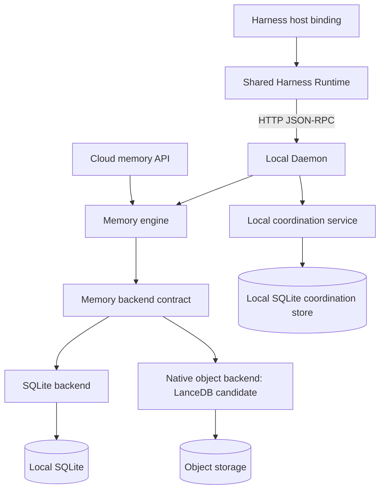

# Unified memory, storage, coordination, and Harness architecture

[中文](unified-architecture.zh-CN.md) · [Terms used](unified-architecture.terms.yaml)

**Status:** draft
**Related:** [accepted direction](../decisions/implemented/2026-11-05-unified-architecture-direction.md), [system model](design.md#responsibility-boundaries)

## Purpose and boundary

This design defines target boundaries for the memory engine, replaceable memory backends, local multi-Agent coordination, and Harness plugins. Interchangeable backends and the shared Harness Runtime are not delivered by this document.

SQLite and native object storage are parallel memory backends. The object backend stores domain data and indexes without SQLite files, SQLite WASM, or a SQLite query executor. LanceDB is the first candidate to validate; choosing it is conditional on the gates below. Existing retrieval implementations need not be preserved when a backend supplies suitable retrieval.

The engine retains graph organization and memory meaning. [Graph activation and consolidation rules](design/active-graph-activation-and-consolidation.md) still govern optional features; this refactor enables or promotes no Lab feature.

## Module boundaries



The coordination database denotes ownership, not a required separate file. The cloud API and memory backends do not create coordination services. Transport stays outside the engine; a local daemon can select either backend if its runtime supports it.

| Module | Owns | Delegates |
| --- | --- | --- |
| Memory engine | Admission, stable identity, provenance, scope and residence, version replacement, node membership, graph transformations, graph expansion, bounded disclosure | Persistence, physical indexes, candidate retrieval |
| Memory backend | Consistent reads, data and index persistence, atomic commits, conflict detection, physical recovery, retrieval execution | Memory meaning and permission decisions |
| Coordination service | Board/task lifecycle, claims, leases, run facts, events, subscriptions and delivery receipts | Local SQLite transactions; host delivery through an explicit capability |
| Harness plugins | Shared session behavior through a Runtime, plus native host events, tool registration and presentation | Memory semantics and coordination transitions to the daemon |

The backend may provide text, vector, hybrid, or graph access. NMG controls relations and their effect on disclosed context. Similarity does not authorize graph changes. Explicit nodes, memberships and edges with suitable lookup and commits suffice; a graph database is not required.

## Storage contract

The boundary covers reads, queries, graph access and commits through domain identities and changes. It excludes SQL, database connections, file pages and provider-specific filters. This TypeScript sketch is not an exported API; its domain types need definitions during implementation.

```ts
interface MemoryBackend {
  openRead(namespace: Namespace): Promise<ReadView>;
  get(view: ReadView, ids: readonly MemoryId[]): Promise<MemoryWithEvidence[]>;
  candidates(view: ReadView, query: CandidateQuery): Promise<CandidatePage>;
  neighbors(view: ReadView, query: GraphQuery): Promise<GraphPage>;
  closeRead(view: ReadView): Promise<void>;
  commit(request: {
    namespace: Namespace;
    operationId: string;
    payloadHash: string;
    expectedRevision: Revision;
    changes: MemoryChangeSet;
  }): Promise<CommitOutcome>;
}
```

`Namespace` is a trusted storage/security boundary selected after authentication. It is distinct from a record's semantic scope, a graph node, or a host-supplied project path. A read view pins one committed revision and has an explicit lifetime; it is not a copy of all records. Its handles remain internal. A separate public `get` request follows the existing evidence/disclosure contract and does not inherit an expired internal snapshot.

`MemoryChangeSet` describes a bounded domain mutation: records, evidence references, versions, node membership and edges that must change together. It excludes host I/O and model calls. The first atomic boundary is one namespace. No transaction spans memory backends, namespaces, or memory and local coordination stores. Physical layout may group isolated namespaces; it need not allocate an engine process or open database per user.

### Commit invariants

1. The same operation ID and canonical payload hash return the recorded receipt without applying the write again, including after a lost reply. Reusing an ID with different content fails. Check the receipt before rejecting a retry for a stale revision.
2. A successful commit makes the memory, required evidence links, version changes, graph changes, required query indexes and receipt visible together. A failed attempt publishes none of that change set. Unreachable staged objects are not visible domain records.
3. A conflict returns a typed refusal. The engine reads a fresh view and replans; it does not blindly replay decisions made from stale duplicate or version state. Stable operation identity and explicit timestamps survive retries.
4. Reads and graph expansion through one view use the same revision. An unsupported mutation fails before publication; a backend must not silently drop edges or provenance.
5. Optional vector preparation may lag. A receipt distinguishes committed data from vector readiness; lexical/filter access to a committed record is available. An ingestion API's queued/accepted acknowledgement is separate from a committed backend receipt.
6. Each backend documents its durability mode and failure boundary. A reply reports durable commit under that mode, not merely an in-process buffer update. External embedding, summarization and object I/O never hold a local SQLite transaction open.

Logical deletion and withdrawal take effect in every public read/search/graph path before physical cleanup. Retained versions do not authorize disclosure of withdrawn content. Recovery and retention policies must keep snapshots readable for their promised lifetime and bound the retention of operation receipts; an expired idempotency window must not silently imply permanent replay protection.

### Retrieval contract

The engine passes a typed query, mandatory namespace/scope/time/withdrawal constraints, a result limit, and a deadline. Filter pushdown may narrow candidates, but every disclosed record is also checked against those constraints. A backend that cannot filter safely fails or uses a bounded safe fallback; it does not return unrestricted data.

Backends may use different analyzers, indexes, ranking and approximate vector search. Scores are backend-local and are not compared across providers. Candidate results identify their records and revision; pagination preserves the read view. A lexical path remains available without an embedding service. NMG can use a backend's hybrid ranking directly, then perform bounded graph expansion and evidence projection. Exact ranking equality with SQLite is not a compatibility requirement; identity, visibility, limits and graph semantics are.

## Backend implementations

### SQLite backend

Use native transactions, indexes and queries. Extract the memory-facing boundary from [the store assembly](../../src/core/store.ts), [base transaction ownership](../../src/core/store/base.ts), and [memory writes](../../src/core/store/writes.ts). Preserve the single owner of each transaction and the synchronous callback rule. Schema migration remains backend-owned. Shared domain invariants move behind the engine boundary rather than being copied into an object adapter.

### Native object backend

Reuse a maintained engine for object storage, indexing, queries and recovery. The adapter maps domain requests to it. NMG need not build general SQL, another vector engine or commit coordination already supplied by that engine.

LanceDB is the first candidate for its embedded object storage, filters, text and vector search. Its [project](https://github.com/lancedb/lancedb) and [transaction specification](https://lance.org/format/table/transaction/) identify capabilities, not NMG compatibility evidence. Table-version atomicity does not establish atomicity across memory, evidence, version and edge tables.

The adapter must demonstrate either one supported atomic representation of a complete change set or a supported transaction across its representations. If neither works without rebuilding a transaction system above LanceDB, reject the layout or candidate. Bulk append support alone is insufficient for state replacement, graph transformations and withdrawal.

SlateDB is the fallback storage foundation when a retrieval-oriented engine cannot satisfy the mutation contract. Its [single-writer/multi-reader model](https://slatedb.io/) requires an explicit writer owner; text/vector retrieval and graph indexes would need additional components. Do not combine both engines by default: two authoritative stores create another consistency boundary.

The existing [cloud adapter](../../onlion/backend/memory-service.ts) and [snapshot storage](../../onlion/backend/storage.mjs) are migration sources. Snapshot export is not the native backend's format. Runtime packaging must be verified against the actual deployment target; native Node bindings do not establish Worker compatibility. A separate service/container is a deployment choice with an explicit cost, not an invisible adapter detail.

## Local coordination

Extract coordination ownership into a local SQLite service/store boundary. Keep board mutations, task/run facts and required receipts in one local transaction when a transition requires them together. Preserve the [event contract](board-event-records.md), [state-space contract](state-spaces.md), and [task-unit storage ownership](task-unit-semantics-obligations/lifecycle-and-integration-prerequisites/host-lifecycle-run-records-and-daemon-clients.md).

Split interfaces and table ownership before deciding whether to split database files. No generic remote memory API exposes a coordination database. A task result becomes durable memory only through an explicit governed memory write. When coordination refers to a memory operation, use a stable operation/reference and retry/reconciliation; do not imply cross-store atomic completion. Session Active Graph state and disclosure remain daemon-owned runtime responsibilities, distinct from the shared Task Board.

## Shared Harness Runtime

Compose the existing [shared session flows](../decisions/implemented/2026-10-16-shared-session-flows.md), [Agent Surface](../../src/integration/agent-surface.ts), [state interface](../../src/integration/state.ts), and [lease transport](../../src/integration/lease-transport.ts) into a host-neutral Runtime. This extends the existing thin-adapter boundary rather than introducing another tool schema or daemon workflow engine.

The Runtime owns recall flow, turn/session fencing, disclosure and feedback, deadlines/cancellation, connection reuse and lifecycle cleanup. A host binding translates native events, registers native tool schemas from the shared definitions, injects context and renders host UI. It never opens a core store. Hooks with only passive injection can implement a subset; MCP need not invent a before-turn event.

Capabilities describe actual host behavior: before-turn interception, context injection, tool-result observation, idle wake and interactive commands. Unsupported capabilities remain explicit, not simulated successes. An enqueue receipt follows successful host acceptance and does not prove that an Agent processed the message. Preserve the [adapter recipe](../../skills/nmg-memory/references/harness-adapters.md)'s daemon non-ownership, session-state fences and permitted fallback rules. The [capability matrix](harness-capability-matrix.md) remains the coverage owner.

## Validation and migration gates

| Gate | Required evidence | Failure response |
| --- | --- | --- |
| Domain contract | Run identical write/replay/conflict, evidence, versions, node/edge mutation, withdrawal, scope and snapshot cases against each backend | Fix the adapter or reject the backend; do not weaken memory invariants |
| LanceDB fit | Pin library/SDK versions; demonstrate the complete mutation's atomic boundary, repeated updates, graph lookup and index readiness | Revisit representation, then evaluate the fallback |
| Deployment | Build and boot the intended Node/cloud target; exercise real object-store access without a live model | Choose an explicit supported runtime or keep the candidate unselected |
| Cost and retrieval | Compare many small namespaces and fewer large ones, cold/warm reads, frequent updates and concurrent writers; measure quality, P95 latency, requests, transferred bytes, memory and compaction | Adjust partition/batch/cache policy or retain SQLite for that workload |
| Harness | Exercise two distinct hosts through the Runtime, including cancellation, unsupported capabilities, session changes and rejected wake delivery | Keep host-specific contracts explicit and repair the shared seam |
| Data migration | Check identity/counts, evidence, versions, graph integrity and representative query coverage; preserve the source and a tested rollback path | Stop cutover and continue on the source |

Start with the contract, a SQLite adapter and characterization tests. Validate the native candidate before porting all features. Route a bounded workload through it, extract coordination ownership, then move two Harness bindings to the Runtime. Keep one authoritative writer per slice; compare through shadow reads, not uncoordinated dual writes.

Migration takes a consistent source snapshot or establishes a catch-up boundary, imports stable IDs and relations, catches up writes and cuts over one namespace with its writer fenced. Carry forward the supported idempotency window or explicitly drain outstanding operations before switching. Keep the source for rollback; once new writes reach the target, rollback needs a tested reverse catch-up or a writer pause, not a blind pointer switch. No format conversion deletes the only retained evidence.

No native-backend benchmark, deployment smoke test, cross-representation transaction test or live Harness test ran for this design. Library selection, partition policy, file separation and performance targets remain gated.
