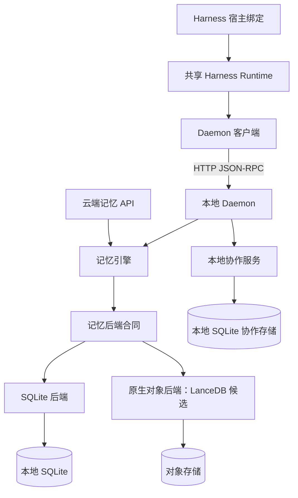

# 统一记忆、存储、协作与 Harness 架构

[English](unified-architecture.md) · [术语](unified-architecture.terms.yaml)

**Status:** draft
**Related:** [已接受的方向](../decisions/implemented/2026-11-05-unified-architecture-direction.zh-CN.md)、[系统模型](design.zh-CN.md#职责边界)

## 目的与边界

本设计划分四项职责：记忆引擎、可替换的记忆后端、仅本地的多 Agent 协作系统，以及 Harness 插件。它为后续实现定义目标合同，不代表可替换后端或共享 Harness Runtime 已经交付。

SQLite 与原生对象存储是并行的记忆后端。对象后端直接保存领域数据与索引，不使用 SQLite 文件、SQLite WASM 或 SQLite 查询执行器。LanceDB 是首个验证对象，是否采用取决于下述门槛。后端提供合适的检索时，无须保留既有检索实现。

引擎保留图组织能力与记忆语义。[图激活与巩固规则](design/active-graph-activation-and-consolidation.zh-CN.md)继续约束可选功能；本次重构不会启用 Lab 功能，也不会将它晋升为默认能力。

## 模块边界



图中的协作数据库表示职责归属，不要求立即拆成独立文件。云端 API 和记忆后端都不创建本地协作服务。传输层位于引擎之外；运行环境支持时，本地 daemon 也可以选择任一种记忆后端。

| 模块 | 拥有的职责 | 委托的职责 |
| --- | --- | --- |
| 记忆引擎 | 准入、稳定身份、来源、作用域与驻留、版本替换、节点归属、图变换、沿图扩展、有界披露 | 持久化、物理索引、候选检索 |
| 记忆后端 | 一致性读取、数据与索引持久化、原子提交、冲突检测、物理恢复、检索执行 | 记忆语义与权限判断 |
| 协作服务 | 黑板／任务生命周期、认领、租约、运行事实、事件、订阅与投递回执 | 本地 SQLite 事务；通过明确能力交给宿主投递 |
| Harness 插件 | 通过 Runtime 共享会话行为，以及原生宿主事件、工具注册与呈现 | 将记忆语义和协作状态转换交给 daemon |

后端可以提供文本、向量、混合检索或图访问原语。NMG 决定哪些关系成立，以及关系如何影响披露的上下文。后端不根据相似度推断图变更。图组织不要求底层是图数据库：明确保存节点、归属与边，并具备足够的查询和提交能力即可。

## 存储合同

共同边界覆盖读取、查询、图访问和提交，使用领域身份与变更表达请求，不暴露 SQL、数据库连接、文件页或供应商专用过滤字符串。以下 TypeScript 是合同草图，不是已导出的 API；引用的领域类型需要在实现时定义。

```ts
interface MemoryBackend {
  openRead(namespace: Namespace): Promise<ReadView>;
  get(view: ReadView, ids: readonly MemoryId[]): Promise<MemoryWithEvidence[]>;
  candidates(view: ReadView, query: CandidateQuery): Promise<CandidatePage>;
  neighbors(view: ReadView, query: GraphQuery): Promise<GraphPage>;
  closeRead(view: ReadView): Promise<void>;
  commit(request: {
    namespace: Namespace;
    operationId: string;
    payloadHash: string;
    expectedRevision: Revision;
    changes: MemoryChangeSet;
  }): Promise<CommitOutcome>;
}
```

`Namespace` 是认证后选定的可信存储／安全边界，不等同于记录的语义作用域、图节点或宿主传入的项目路径。读取视图固定一个已提交版本，具有明确生命周期，不复制全部记录；句柄仅供内部使用。独立的公开 `get` 请求遵循既有证据／披露合同，不继承已经过期的内部快照。

`MemoryChangeSet` 表达有界的领域变更：必须一起修改的记录、证据引用、版本、节点归属与边，不包含宿主 I/O 和模型调用。第一版原子边界是单个命名空间。事务不跨记忆后端、命名空间，也不跨记忆与本地协作存储。物理布局可以组合承载相互隔离的命名空间，不要求每个用户都有独立引擎进程或打开的数据库。

### 提交不变量

1. 相同操作 ID 和规范化内容哈希返回已保存的回执，不重复应用写入，包括响应丢失后的重试。同一 ID 携带不同内容必须失败。先检查回执，再因版本过期拒绝重试。
2. 提交成功时，记忆、必要证据引用、版本变更、图变更、必要查询索引和回执一起可见。失败尝试不发布其中任何部分。不可达的暂存对象不属于可见领域记录。
3. 冲突返回有类型的拒绝。引擎读取新视图后重新计算，不盲目重放基于旧去重或旧版本状态作出的决定。重试保留稳定操作身份和明确时间戳。
4. 同一视图中的读取与沿图扩展使用同一版本。不支持的变更必须在发布前失败，不能静默丢弃边或来源信息。
5. 可选向量准备可以滞后。回执区分数据已提交与向量就绪；已提交记录可以通过词法／过滤路径访问。导入 API 的排队／已接受应答与后端提交回执分开。
6. 各后端说明其持久性模式及故障边界。响应表示该模式下的持久提交，不只是进程内缓冲区已更新。外部 embedding、归纳和对象 I/O 不得占用本地 SQLite 事务。

逻辑删除与撤回必须在物理清理前作用于全部公开读取、检索与图访问路径。保留历史版本不构成披露撤回内容的授权。恢复与保留策略保证快照在约定生命周期内可读，并约束操作回执保留；幂等窗口过期不能被默认为永久重放保护。

### 检索合同

引擎传入有类型的查询、强制命名空间／作用域／时间／撤回约束、结果上限和截止时间。过滤下推可以缩小候选，但每条披露记录还必须按这些约束校验。后端不能安全过滤时，必须失败或使用有界且安全的回退，不能返回无限制的数据。

后端可以采用不同分词、索引、排序及近似向量检索。分数仅在各后端内部有效，不跨供应商比较。候选结果标识记录及版本，分页保留读取视图。没有 embedding 服务时仍保留词法路径。NMG 可以直接使用后端混合排序，再进行有界的图扩展和证据投影。不要求排序与 SQLite 完全相同；身份、可见性、限制和图语义必须兼容。

## 后端实现

### SQLite 后端

使用原生事务、索引与查询。从[Store 组装](../../src/core/store.ts)、[基类事务所有权](../../src/core/store/base.ts)和[记忆写入](../../src/core/store/writes.ts)中抽出面向记忆的边界。保留单一事务所有者与同步回调约束。schema 迁移归后端所有。共享领域不变量收拢到引擎边界之后，避免复制进对象适配器。

### 原生对象后端

优先复用提供对象存储、索引、查询和恢复能力的维护中引擎。适配器将 NMG 领域请求映射到该引擎；所选引擎已经提供相应能力时，不要求 NMG 实现通用 SQL 层、另一套向量引擎或自建对象提交协调器。

LanceDB 是首个候选，因为其嵌入式检索模型包含对象存储、过滤、文本与向量查询。[项目说明](https://github.com/lancedb/lancedb)和 [Lance 事务规范](https://lance.org/format/table/transaction/)说明可调查的能力，不构成 NMG 兼容性证据。表版本的原子性本身不证明独立记忆、证据、版本与边表之间也具有原子性。

适配器必须证明完整变更集可以使用一种受支持的原子表示，或使用跨这些表示的受支持事务。两者都不可行、必须在 LanceDB 之上重建事务系统时，拒绝该布局或候选。只有批量追加能力，不足以支撑状态替换、图变换和撤回。

检索型引擎不能满足变更合同时，SlateDB 是后备存储底座。它的[单写者／多读者模型](https://slatedb.io/)需要明确写入所有者；文本／向量检索和图索引需要额外组件。默认不组合两个引擎，避免两个权威存储形成新的协调边界。

既有[云端适配器](../../onlion/backend/memory-service.ts)与[快照存储](../../onlion/backend/storage.mjs)是迁移源。快照导出不是原生后端的数据格式。必须针对实际部署目标验证打包与运行；原生 Node 绑定不能证明 Worker 兼容。独立服务／容器是需要明确成本的部署选择，不是适配器中隐藏的细节。

## 本地协作

从组合 Store 中抽出协作所有权，形成面向本地 SQLite 的服务／存储边界。一项转换要求黑板变更、任务／运行事实及必要回执一起提交时，继续使用同一个本地事务。保留[事件合同](board-event-records.zh-CN.md)、[状态空间合同](state-spaces.zh-CN.md)及[Task-Unit 存储所有权](task-unit-semantics-obligations/lifecycle-and-integration-prerequisites/host-lifecycle-run-records-and-daemon-clients.zh-CN.md)。

先拆接口和表的所有权，再决定是否拆数据库文件。通用远程记忆 API 不暴露协作数据库。任务结果只有经过明确且受治理的记忆写入，才能成为持久记忆。协作引用记忆操作时，使用稳定操作／引用与重试／对账机制，不暗示跨存储原子完成。session Active Graph 状态与披露继续由 daemon 的运行时负责，与共享 Task Board 分离。

## 共享 Harness Runtime

将既有[共享会话流程](../decisions/implemented/2026-10-16-shared-session-flows.zh-CN.md)、[Agent Surface](../../src/integration/agent-surface.ts)、[状态接口](../../src/integration/state.ts)和[租约传输](../../src/integration/lease-transport.ts)组合为宿主无关的 Runtime。它延伸现有薄适配器边界，不创建另一套工具 schema 或 daemon 工作流引擎。

Runtime 负责召回流程、回合／会话隔离、披露与反馈、截止时间／取消、连接复用和生命周期清理。宿主绑定负责翻译原生事件、按共享定义注册原生工具 schema、注入上下文和渲染宿主 UI，不打开核心 Store。仅支持被动注入的 hook 可以实现能力子集；MCP 无须虚构回合前事件。

能力声明描述宿主实际支持的行为：回合前拦截、上下文注入、工具结果观察、空闲唤醒及交互命令。不支持的能力必须明确，不能模拟成功。入队回执必须在宿主接受后产生，但不证明 Agent 已处理消息。保留[适配器指南](../../skills/nmg-memory/references/harness-adapters.zh-CN.md)的共享 daemon 非所有权、会话状态 fence 与允许的回退规则。[能力矩阵](harness-capability-matrix.zh-CN.md)继续拥有覆盖情况。

## 验证与迁移门槛

| 门槛 | 必要证据 | 失败处理 |
| --- | --- | --- |
| 领域合同 | 两个后端运行同一套写入／重放／冲突、证据、版本、节点／边变更、撤回、作用域和快照用例 | 修正适配器或拒绝后端，不削弱记忆不变量 |
| LanceDB 适配 | 固定库／SDK 版本；证明完整变更的原子边界、重复更新、图查询及索引就绪 | 调整表示，再评估后备候选 |
| 部署 | 在目标 Node／云端环境构建并启动，使用真实对象存储完成无在线模型的验证 | 明确选择受支持运行环境，或保持候选未定 |
| 成本与检索 | 比较大量小命名空间和少量大空间、冷／热读取、频繁更新与并发写者；测质量、P95 延迟、请求数、传输字节、内存和压缩 | 调整分区／批量／缓存策略，或为该负载保留 SQLite |
| Harness | 两种不同宿主通过 Runtime 验证取消、不支持能力、会话切换及拒绝唤醒投递 | 明确宿主合同差异，修正共享接缝 |
| 数据迁移 | 检查身份／数量、证据、版本、图完整性与代表性查询覆盖；保留源和经过验证的回退路径 | 停止切换，继续使用源 |

先实现合同和 SQLite 适配器，并以特征测试记录当前行为。在迁移全部功能前验证原生候选。随后接入有界记忆负载，拆清协作所有权，并将两种 Harness 绑定迁入 Runtime。每个切片保留单一权威写者；使用影子读取比较，避免无协调双写。

迁移取得一致源快照或明确追赶边界，导入稳定 ID 与关系，追平写入，并在约束写者后按命名空间切换。保留受支持的幂等窗口，或在切换前明确排空未完成操作。保留源供回退；目标接收新写入后，回退需要经过验证的反向追赶或暂停写者，不能直接切回指针。格式转换不得删除唯一保留的证据。

本文件记录设计意图。撰写文档不构成原生后端基准、部署冒烟、跨表示事务测试或真实 Harness 测试。库的最终选型、物理分区策略、文件拆分和性能目标，仍须在实现中通过这些门槛确定。
