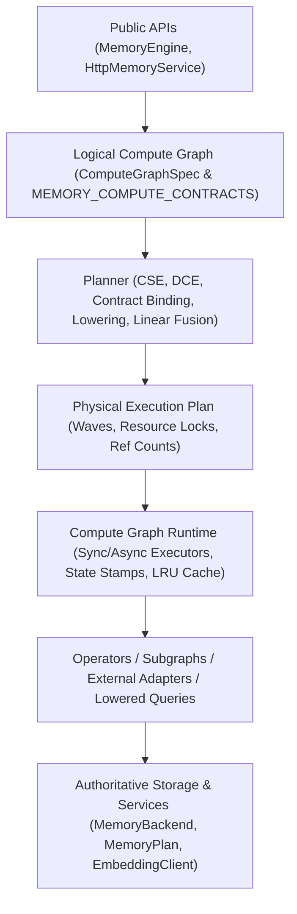

# Unified Memory Compute Engine

[中文](compute-engine.zh-CN.md) · [Terms used](compute-engine.terms.yaml)

**Status:** current
**Authority:** [Unified architecture](../unified-architecture.md)

## Layered execution boundary

`MemoryEngine`, `HttpMemoryService`, and `PortableMemoryService` separate business contracts and transactional persistence from retrieval, ranking, graph projection, preprocessing, and change-plan computation:

- **Logical graph (`ComputeGraphSpec`):** expresses typed dataflow and domain contracts (`src/core/compute-contracts.ts`) without binding concrete storage queries or execution order tricks.
- **Physical execution plan (`PhysicalExecutionPlan`):** compiles the logical graph in `src/core/compute-planner.ts` (cached per graph identity, registry generation, and plan options), resolves `$contract` nodes, applies common subexpression elimination (`pure` nodes) and dead-code elimination (preserving non-eliminable `write`, `nondeterministic`, and `opaque` nodes), lowers `relational_query` expressions (`sqlite_pushdown` or `portable_scan`), optionally fuses linear `pure` sync chains, partitions each wave into resource-conflict-free parallel groups and serial nodes, and computes exact output consumer reference counts.
- **Runtime (`src/core/compute-graph.ts`):** executes physical plans over sync or async channels. When no `ComputeMemoCache` is supplied, the zero-hash fast path skips JSON canonicalization and SHA-256 hashing completely.

## Node realizations and progressive capabilities

Every compute node accepts five interchangeable realization forms behind unified port semantics:

1. Registered operator name (`op: string`) in a `ComputeRegistry`.
2. Standalone algorithm module (`ComputeOperatorModule` via `registry.registerModule`).
3. Nested subgraph (`node.subgraph` or composite `graphAsOperator`).
4. Inline closure or third-party black-box adapter (`node.fn` or `adaptExternalAlgorithm`).
5. Compilable structured expression (`node.expression`, including `relational_query` lowered to SQLite pushdown or portable scan).

Operators declare capabilities progressively via `ComputeRegisterOptions` resolved by `resolveCapabilities`:

- **Effect classes (`ComputeEffectKind`):** `"pure"`, `"read"`, `"nondeterministic"`, `"write"`, `"opaque"`. Unannotated black-box operators default conservatively to `"opaque"` (`cacheable: false`, `parallelSafe: false`, `reorderable: false`, `eliminable: false`).
- **Cache safety and invalidation:**
  - Mutable objects stored in or read from `ComputeMemoCache` (bounded LRU, default 512 entries) are isolated by `structuredClone` unless deeply frozen (`immutableOutput` fast path); uncloneable values skip caching rather than aliasing mutable state.
  - Closure identities use explicit `COMPUTE_CACHE_TOKEN` or per-function `WeakMap` monotonic IDs instead of `.toString()` hashes.
  - `effect: "read"` operators with `cacheable: true` require matching `ComputeStateStamp` fields (`namespace`, `revision` / `snapshotId`, `modelVersion`, clock) attached via `attachStateStamp`; missing stamps bypass caching safely.
  - Uncacheable, `write`, `nondeterministic`, and `opaque` nodes emit unique taint tokens that propagate to all transitive downstream consumers, while `SUBGRAPH_OPERATOR_META` recomputes dynamic child capability and signature hashes for nested `graphAsOperator` wrappers.
  - Intermediate buffers are released from live execution maps as soon as downstream ref counts reach zero.

## Production graph coverage and module dependencies

Production memory paths execute registered compute graphs through narrow ports (`MemorySnapshotPort` in `src/core/memory/hydration.ts` for reads; `MemoryPlan` inside `MemoryEngine.mutate` for uncommitted change plans):

| Surface | Production Graph (`ComputeGraphSpec`) | Registry / Owner |
| --- | --- | --- |
| Search & context assembly | `DEFAULT_ENGINE_SEARCH_GRAPH` | `ENGINE_SEARCH_REGISTRY` (`src/core/memory/search-compute-graph.ts`); supplements ranks `81..100` in hybrid searches with `limit > 80` via adjacent source turns and `same_state` relational peers while keeping `1..80` frozen |
| Exact record hydration & expansion | `DEFAULT_GET_CONTEXT_GRAPH` | `ENGINE_VIEW_REGISTRY` (`src/core/memory/view-compute-graphs.ts`) |
| Bounded neighborhood browsing | `DEFAULT_NEIGHBORHOOD_GRAPH` | `ENGINE_VIEW_REGISTRY` (`src/core/memory/view-compute-graphs.ts`) |
| Multi-dimensional pivot graph projection | `DEFAULT_PROJECT_GRAPH` | `ENGINE_VIEW_REGISTRY` (`src/core/memory/view-compute-graphs.ts`) |
| User profile scope projection | `DEFAULT_USER_PROFILE_GRAPH` | `ENGINE_VIEW_REGISTRY` (`src/core/memory/view-compute-graphs.ts`) |
| Batch remember change planning | `DEFAULT_REMEMBER_PLAN_GRAPH` | `ENGINE_WRITE_REGISTRY` (`src/core/memory/write-compute-graphs.ts`) |
| Lifecycle & link mutation planning | `DEFAULT_LIFECYCLE_PLAN_GRAPH` | `ENGINE_WRITE_REGISTRY` (`src/core/memory/write-compute-graphs.ts`) |
| Piecewise 3-band candidate rerank | `DEFAULT_PIECEWISE_RERANK_GRAPH` | `RERANK_COMPUTE_REGISTRY` (`src/core/memory/piecewise-rerank.ts`); mid band (`[6..20]`) applies `w_chrono_seq_pivot` over groups with at least two distinct timestamps |
| HTTP multi-clause fusion & page stitch | `DEFAULT_HTTP_SEARCH_GRAPH` | `HTTP_SEARCH_COMPUTE_REGISTRY` (`src/integration/http-search-graph.ts`) |
| HTTP turn preprocessing | `DEFAULT_HTTP_WRITE_PREPROCESS_GRAPH` | `HTTP_WRITE_PREPROCESS_REGISTRY` (`src/integration/http-write-preprocess.ts`) |
| HTTP profile supplement projection | `DEFAULT_HTTP_PROFILE_GRAPH` | `HTTP_PROFILE_COMPUTE_REGISTRY` (`src/integration/http-profile-view.ts`) |

- **Dependency isolation:** `tests/core/compute-architecture-guardrails.test.ts` enforces zero imports from SQLite, LanceDB, or `MemoryEngine` inside core compute, planner, domain graph, and hydration modules, and zero compute imports inside SQLite/LanceDB storage modules.
- **Transactional coupling boundary:** `MemoryEngine` retains `openRead`/`closeRead` lifetime control, synchronous pre-read input validation, and optimistic `mutate` retry/receipt replay over `MemoryBackend.commit`. Write graphs only plan entity mutations onto `MemoryPlan` and never commit directly.

## Operator onboarding and extension boundaries

When adding or evaluating memory algorithms:

1. Check `MEMORY_COMPUTE_CONTRACTS` in `src/core/compute-contracts.ts` before adding a new operator so compatible contracts share callers and intermediate results.
2. Separate **engineering optimizations** (semantics-preserving transforms such as CSE, DCE, SQL predicate pushdown, and `fused_chain` linear fusion, validated by exact output equivalence and latency/memory deltas) from **algorithmic experiments** (semantics-changing scorers or recall branches evaluated over frozen benchmarks and `findParetoOptimalGraphs`).
3. Retire superseded implementations once callers migrate rather than retaining parallel production paths.
4. Keep external lowering lightweight: structured `relational_query` expressions lower directly to `SqliteMemoryBackend.projectMemories` SQL pushdown or portable `scan` fallback, and pure linear sync JS chains lower via `enableLinearFusion` for V8 inline execution without introducing external compiler toolchains.
