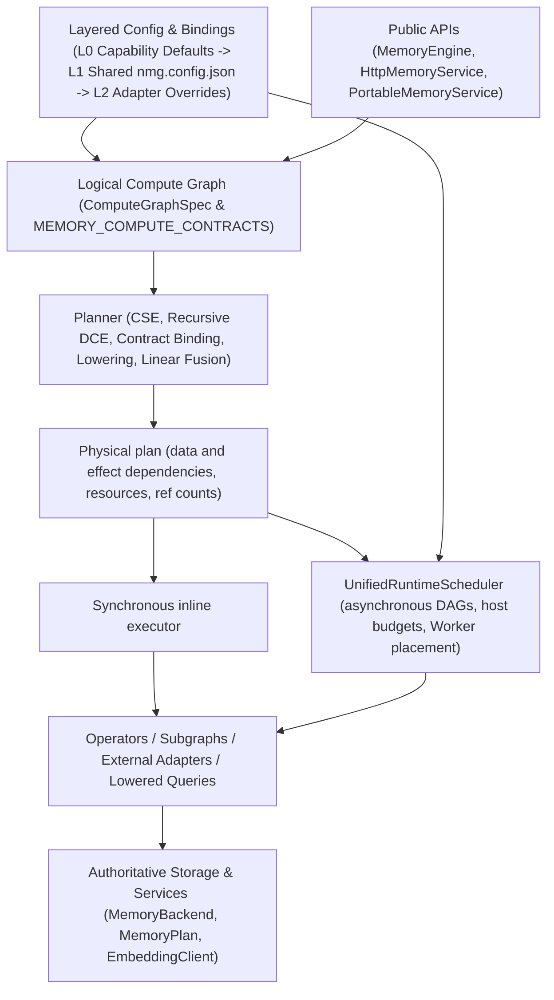

# Unified Memory Compute Engine

[中文](compute-engine.zh-CN.md) · [Terms used](compute-engine.terms.yaml)

**Status:** current
**Authority:** [Unified architecture](../unified-architecture.md)

## Layered execution boundary

`MemoryEngine`, `HttpMemoryService`, and `PortableMemoryService` separate business contracts and transactional persistence from retrieval, ranking, graph projection, preprocessing, and change-plan computation:

- **Logical graph (`ComputeGraphSpec`):** expresses typed dataflow and domain contracts (`src/core/compute-contracts.ts`) without binding concrete storage queries or execution order tricks.
- `resolveEffectiveNmgConfig` binds L0 public defaults and registered graph recipes, L1 shared configuration, and L2 host overrides. `bindMemoryEngineConfig` supplies search, views, projection, write and lifecycle graphs to the engine. HTTP service options use the same resolved configuration for clause fusion, preprocessing and profile rendering. Bindings carry provenance and contribute to result identity. Unapproved semantic variants raise `PolicyViolationError`.
- `PhysicalExecutionPlan` resolves `$contract`, lowers structured expressions, eliminates eligible common or dead nodes, and can fuse linear synchronous pure chains without named resources. The planner emits unique-parent readiness counts, effect-order dependencies and consumer counts. Plans are keyed by graph and registry identity, registry generation, and semantic options.
- `executeComputeGraph` submits every asynchronous plan to `UnifiedRuntimeScheduler.executePlan`. Child plans recursively enter the same dependency loop. `evaluateSyncComputeGraph` retains a synchronous topological loop with no queue or hashing for ordinary calls without memoization. Both use common operator, input, memo-signature and output-lifetime rules.

## Runtime policy and resource ownership

Node daemon and portable RPC paths resolve L1 from `NMG_CONFIG_PATH` or the service data directory. The project STG engines use that same resolver. Local HTTP uses the database directory for L1 and its own `runtime` or `bindings` overrides as L2. Onlion accepts the same L1 JSON through `NMG_CAPABILITY_CONFIG` and creates a scheduler with an empty local thread domain per request-scoped snapshot. This preserves the request lifetime for WASM SQLite and embedding handles.

| Policy | Execution effect |
| --- | --- |
| `runtime.profile` | Selects the load hysteresis, background concurrency, CPU budget and Worker allowance from `HostLoadGovernor`. |
| `runtime.objective` | Chooses the EFT margin for responding inline versus dispatching to the selected Worker. |
| `runtime.maxWorkers` | Caps placement against the host allowance and domain availability. Zero uses automatic sizing. Threads are lazy and idle threads retire. |
| `runtime.minOffloadCpuMs` | Rejects transfer for an operator and input-size bucket below the CPU estimate floor. |
| `runtime.maxConcurrentBackground` | Caps admitted background operations, including outstanding provider I/O. Foreground work can reduce the cap to one. |
| `runtime.backgroundCpuBudgetMs` | Caps the profile CPU allowance per 100 ms admission window. Inline slices and measured Worker CPU charge the budget. Worker admission reserves estimated CPU until settlement. |
| `runtime.starvationMaxWaitMs` | Ages waiting background tasks while retaining resource and concurrency limits. |

Physical runtime policies are excluded from result identity. `maintenance` and `stgSync` still parse for compatibility with existing consumers. The engine's explicit maintenance actions and project operations own those lifecycles. Claim-driven STG consolidation consumes its separate `stgConsolidation` policy.

Ready nodes compete by foreground lane and critical-path rank. A conflicting read/write resource set waits without a partial lock or execution slot. The runtime holds acquired locks through actual settlement, including a timed-out write, and aborts queued siblings on failure. Graph completion drains started siblings before the caller closes its snapshot. A dynamic nested task declaring a lock while its parent holds named resources fails at admission. Ordinary child plans acquire their own resources. Write-plan state belongs to each mutation and durable writer arbitration remains with revision-checked commit and receipt replay.

CPU placement prices runnable CPU work, caller-resident input bytes, observed communication, and the selected leaf's availability. Approved Worker operators share their implementation with inline execution. Larger default ranking batches can enter this path, while small batches, alternate graphs and non-transferable data can use the inline implementation. A Worker error propagates and cancellation terminates its active thread. Node and the host OS provide thread execution and CPU counters. [Node.js process API](https://nodejs.org/docs/latest-v22.x/api/process.html#processthreadcpuusagepreviousvalue)

The governor samples host CPU times and event-loop pressure. Hysteresis and background event-loop yields let host capacity recover gradually. Optional diagnostics record queue and resource wait, synchronous thread CPU, Worker queue and communication time, and post-yield wall time for asynchronous operators. Post-yield wall time includes application continuations. Arbitrary synchronous JavaScript remains non-preemptible. See the matched [production and synthetic measurements](../../experiments/runtime/unified-runtime-convergence-2026-11-25.md).

## Node realizations and progressive capabilities

Every compute node accepts five interchangeable realization forms behind unified port semantics:

1. Registered operator name (`op: string`) in a `ComputeRegistry`.
2. Standalone algorithm module (`ComputeOperatorModule` via `registry.registerModule`).
3. Nested subgraph (`node.subgraph` or composite `graphAsOperator`).
4. Inline closure or third-party black-box adapter (`node.fn` or `adaptExternalAlgorithm`).
5. Compilable structured expression (`node.expression`, including `relational_query` lowered to SQLite pushdown or portable scan).

Operators declare capabilities progressively via `ComputeRegisterOptions` resolved by `resolveCapabilities`:

- **Effect classes (`ComputeEffectKind`):** `"pure"`, `"read"`, `"nondeterministic"`, `"write"`, `"opaque"`. Unannotated black-box operators default conservatively to `"opaque"` (`cacheable: false`, `parallelSafe: false`, `reorderable: false`, `eliminable: false`).
- **Cache safety and invalidation:**
  - Mutable objects stored in or read from `ComputeMemoCache` (bounded LRU, default 512 entries) are isolated by `structuredClone` unless deeply frozen (`immutableOutput` fast path); uncloneable values skip caching rather than aliasing mutable state.
  - Closure identities use explicit `COMPUTE_CACHE_TOKEN` or per-function `WeakMap` monotonic IDs instead of `.toString()` hashes.
  - `effect: "read"` operators with `cacheable: true` require matching `ComputeStateStamp` fields (`namespace`, `revision` / `snapshotId`, `modelVersion`, clock) attached via `attachStateStamp`; missing stamps bypass caching safely.
  - Uncacheable, `write`, `nondeterministic`, and `opaque` nodes emit unique taint tokens that propagate to all transitive downstream consumers, while `SUBGRAPH_OPERATOR_META` recomputes dynamic child capability and signature hashes for nested `graphAsOperator` wrappers.
  - Intermediate buffers are released from live execution maps as soon as downstream ref counts reach zero.

## Production graph coverage and module dependencies

Production memory paths execute registered compute graphs through narrow ports (`MemorySnapshotPort` in `src/core/memory/hydration.ts` for reads; `MemoryPlan` inside `MemoryEngine.mutate` for uncommitted change plans):

| Surface | Production Graph (`ComputeGraphSpec`) | Registry / Owner |
| --- | --- | --- |
| Search & context assembly | `DEFAULT_ENGINE_SEARCH_GRAPH` | `ENGINE_SEARCH_REGISTRY` (`src/core/memory/search-compute-graph.ts`); supplements ranks `81..100` in hybrid searches with `limit > 80` via adjacent source turns and `same_state` relational peers while keeping `1..80` frozen |
| Exact record hydration & expansion | `DEFAULT_GET_CONTEXT_GRAPH` | `ENGINE_VIEW_REGISTRY` (`src/core/memory/view-compute-graphs.ts`) |
| Bounded neighborhood browsing | `DEFAULT_NEIGHBORHOOD_GRAPH` | `ENGINE_VIEW_REGISTRY` (`src/core/memory/view-compute-graphs.ts`) |
| Multi-dimensional pivot graph projection | `DEFAULT_PROJECT_GRAPH` | `ENGINE_VIEW_REGISTRY` (`src/core/memory/view-compute-graphs.ts`) |
| User profile scope projection | `DEFAULT_USER_PROFILE_GRAPH` | `ENGINE_VIEW_REGISTRY` (`src/core/memory/view-compute-graphs.ts`) |
| Batch remember change planning | `DEFAULT_REMEMBER_PLAN_GRAPH` | `ENGINE_WRITE_REGISTRY` (`src/core/memory/write-compute-graphs.ts`) |
| Lifecycle & link mutation planning | `DEFAULT_LIFECYCLE_PLAN_GRAPH` | `ENGINE_WRITE_REGISTRY` (`src/core/memory/write-compute-graphs.ts`) |
| Piecewise 3-band candidate rerank | `DEFAULT_PIECEWISE_RERANK_GRAPH` | `RERANK_COMPUTE_REGISTRY` (`src/core/memory/piecewise-rerank.ts`); mid band (`[6..20]`) applies `w_chrono_seq_pivot` over groups with at least two distinct timestamps |
| HTTP multi-clause fusion & page stitch | `DEFAULT_HTTP_SEARCH_GRAPH` | `HTTP_SEARCH_COMPUTE_REGISTRY` (`src/integration/http-search-graph.ts`); shares canonical dual-channel fusion, chronological ordering, tail capping (`capSupplementalTailScores`), and page stitching (`src/core/memory/page-stitch-operators.ts`) with engine search, `retrieval-graph.ts`, and `PortableMemoryService` |
| HTTP turn preprocessing | `DEFAULT_HTTP_WRITE_PREPROCESS_GRAPH` | `HTTP_WRITE_PREPROCESS_REGISTRY` (`src/integration/http-write-preprocess.ts`) |
| HTTP profile supplement projection | `DEFAULT_HTTP_PROFILE_GRAPH` | `HTTP_PROFILE_COMPUTE_REGISTRY` (`src/integration/http-profile-view.ts`) |

- **Dependency isolation:** `tests/core/compute-architecture-guardrails.test.ts` enforces zero imports from SQLite, LanceDB, or `MemoryEngine` inside core compute, planner, domain graph, and hydration modules, and zero compute imports inside SQLite/LanceDB storage modules.
- **Transactional coupling boundary:** `MemoryEngine` retains `openRead`/`closeRead` lifetime control, synchronous pre-read input validation, and optimistic `mutate` retry/receipt replay over `MemoryBackend.commit`. Write graphs only plan entity mutations onto `MemoryPlan` and never commit directly.
- **Entry points.** CLI, daemon RPC and MCP host adapters reach `PortableMemoryService` and its SQLite/LanceDB engine. WorkBuddy and DSH use shared recall, workspace and coordination helpers on the client side. Local HTTP and Onlion delegate retrieval to `HttpMemoryService`; Onlion owns partition and pending-log visibility. `runGraphExperiments` and decoupled retrieval use the production graph executor. Agent task scheduling in the OoO integration owns session, authorization and task-commit lifecycles.

## Operator onboarding and extension boundaries

When adding or evaluating memory algorithms:

1. Check `MEMORY_COMPUTE_CONTRACTS` in `src/core/compute-contracts.ts` before adding a new operator so compatible contracts share callers and intermediate results.
2. Separate **engineering optimizations** (semantics-preserving transforms such as CSE, DCE, SQL predicate pushdown, and `fused_chain` linear fusion, validated by exact output equivalence and latency/memory deltas) from **algorithmic experiments** (semantics-changing scorers or recall branches evaluated over frozen benchmarks and `findParetoOptimalGraphs`).
3. Retire superseded implementations once callers migrate rather than retaining parallel production paths.
4. Keep external lowering lightweight: structured `relational_query` expressions lower directly to `SqliteMemoryBackend.projectMemories` SQL pushdown or portable `scan` fallback, and pure linear sync JS chains lower via `enableLinearFusion` for V8 inline execution without introducing external compiler toolchains.
