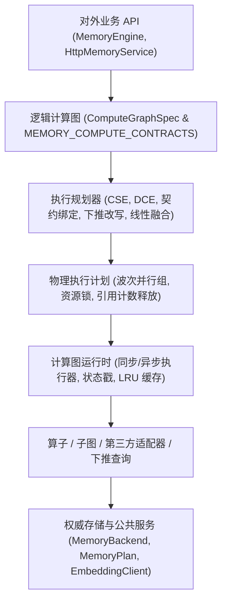

# 统一记忆计算引擎

[English](compute-engine.md) · [术语](compute-engine.terms.yaml)

**Status:** current
**Authority:** [统一架构](../unified-architecture.zh-CN.md)

## 分层执行边界

`MemoryEngine`、`HttpMemoryService` 与 `PortableMemoryService` 将业务契约与事务持久化同检索、重排、图投影、写入预处理及变更计划计算分离：

- **逻辑计算图（`ComputeGraphSpec`）**：使用 `src/core/compute-contracts.ts` 中的领域契约表达计算需求与数据流，不固化具体后端查询或执行顺序优化。
- **物理执行计划（`PhysicalExecutionPlan`）**：由 `src/core/compute-planner.ts` 编译（按图对象引用、注册表代数与规划选项缓存），解析 `$contract` 契约节点，对 `pure` 节点执行公共子表达式消除，对无消费纯节点执行死代码消除（保留 `write`、`nondeterministic` 与 `opaque` 节点），将 `relational_query` 表达式改写为 `sqlite_pushdown` 或 `portable_scan`，可选将单消费者同步 `pure` 链路融合为 `fused_chain`，按读写／独占资源冲突划分并行组与串行节点，并生成精确下游引用计数表。
- **计算图运行时（`src/core/compute-graph.ts`）**：驱动同步与异步物理计划执行；未传入 `ComputeMemoCache` 时走零哈希快路径，完全跳过 JSON 规范化与 SHA-256 计算。

## 节点实现形态与渐进式能力声明

所有计算节点在同一套端口调用语义下支持五种可互换实现形态：

1. 注册在 `ComputeRegistry` 中的命名算子（`op: string`）。
2. 独立算法模块（通过 `registry.registerModule` 注册 `ComputeOperatorModule`）。
3. 递归嵌套子图（`node.subgraph` 或复合算子 `graphAsOperator`）。
4. 内联函数或第三方黑盒适配器（`node.fn` 或 `adaptExternalAlgorithm`）。
5. 可编译结构化表达式（`node.expression`，包括可下推至 SQLite 或便携扫描的 `relational_query`）。

算子通过 `ComputeRegisterOptions` 渐进式声明能力，并由 `resolveCapabilities` 按保守原则解析：

- **副作用类别（`ComputeEffectKind`）**：支持 `"pure"`、`"read"`、`"nondeterministic"`、`"write"`、`"opaque"`。缺省优化元数据的黑盒算子严格按 `"opaque"` 处理（禁止缓存、禁止并行、禁止重排、禁止死代码消除）。
- **缓存与状态安全边界**：
  - 写入和读取有界 LRU `ComputeMemoCache`（默认上限 512 条）的可变对象经 `structuredClone` 隔离，仅深冻结值（或显式 `immutableOutput`）直接复用；不可克隆对象自动跳过缓存。
  - 闭包函数身份通过显式 `COMPUTE_CACHE_TOKEN` 或 `WeakMap` 单调函数标识区分，不再仅依赖源码文本哈希。
  - 标记 `cacheable: true` 的 `"read"` 算子须在上下文中通过 `attachStateStamp` 携带所需外部依赖状态戳（`namespace`、`revision`／`snapshotId`、`modelVersion`、时钟）；缺少状态戳时安全退回不缓存。
  - 不可缓存、`"write"`、`"nondeterministic"` 与 `"opaque"` 节点生成独立污染标记并向全部下游节点传播；`SUBGRAPH_OPERATOR_META` 动态重算 `graphAsOperator` 复合能力与签名。
  - 物理执行器在下游引用计数归零后立即释放中间输出槽位。

## 生产计算图覆盖与模块依赖

生产路径通过窄快照端口（只读快照 `MemorySnapshotPort` 位于 `src/core/memory/hydration.ts`；未提交变更草稿 `MemoryPlan` 位于 `MemoryEngine.mutate` 内）执行计算图：

| 业务入口 | 生产计算图（`ComputeGraphSpec`） | 注册表与所属模块 |
| --- | --- | --- |
| 搜索与上下文组装 | `DEFAULT_ENGINE_SEARCH_GRAPH` | `ENGINE_SEARCH_REGISTRY`（`src/core/memory/search-compute-graph.ts`） |
| 精确记录与图扩展读取 | `DEFAULT_GET_CONTEXT_GRAPH` | `ENGINE_VIEW_REGISTRY`（`src/core/memory/view-compute-graphs.ts`） |
| 有界邻域浏览 | `DEFAULT_NEIGHBORHOOD_GRAPH` | `ENGINE_VIEW_REGISTRY`（`src/core/memory/view-compute-graphs.ts`） |
| 多维关系图按需投影 | `DEFAULT_PROJECT_GRAPH` | `ENGINE_VIEW_REGISTRY`（`src/core/memory/view-compute-graphs.ts`） |
| 用户画像范围投影 | `DEFAULT_USER_PROFILE_GRAPH` | `ENGINE_VIEW_REGISTRY`（`src/core/memory/view-compute-graphs.ts`） |
| 批量写入变更计划 | `DEFAULT_REMEMBER_PLAN_GRAPH` | `ENGINE_WRITE_REGISTRY`（`src/core/memory/write-compute-graphs.ts`） |
| 生命周期与关系变更计划 | `DEFAULT_LIFECYCLE_PLAN_GRAPH` | `ENGINE_WRITE_REGISTRY`（`src/core/memory/write-compute-graphs.ts`） |
| 三段式因果重排 | `DEFAULT_PIECEWISE_RERANK_GRAPH` | `RERANK_COMPUTE_REGISTRY`（`src/core/memory/piecewise-rerank.ts`） |
| HTTP 多子句融合与拼页 | `DEFAULT_HTTP_SEARCH_GRAPH` | `HTTP_SEARCH_COMPUTE_REGISTRY`（`src/integration/http-search-graph.ts`） |
| HTTP 写入对话预处理 | `DEFAULT_HTTP_WRITE_PREPROCESS_GRAPH` | `HTTP_WRITE_PREPROCESS_REGISTRY`（`src/integration/http-write-preprocess.ts`） |
| HTTP 画像摘要投影 | `DEFAULT_HTTP_PROFILE_GRAPH` | `HTTP_PROFILE_COMPUTE_REGISTRY`（`src/integration/http-profile-view.ts`） |

- **依赖方向护栏**：`tests/core/compute-architecture-guardrails.test.ts` 自动化校验核心计算层、规划器、领域计算图与读取视图模块零导入 SQLite、LanceDB 或 `MemoryEngine`，同时存储后端模块零导入计算层。
- **保留的事务耦合边界**：`MemoryEngine` 仅保留参数前置校验、只读快照打开／关闭生命周期及基于 `MemoryBackend.commit` 的乐观并发重试／凭据重放。写入图仅在 `MemoryPlan` 上生成未提交变更，不直接提交数据库事务。

## 算子接入规范与扩展边界

新增或评估算法时遵循以下规则：

1. 先检查 `src/core/compute-contracts.ts` 中的 `MEMORY_COMPUTE_CONTRACTS`，优先匹配或复用已有契约与中间结果，不在业务入口复制链路。
2. 明确区分**工程优化**（保持语义严格等价的 CSE、DCE、SQL 谓词下推、线性 `fused_chain` 融合，按输出一致性和延迟／内存指标验收）与**算法实验**（允许改变排序与召回结果的算子／配方变更，按冻结评测集与 `findParetoOptimalGraphs` 帕累托前沿验收）。
3. 当新实现完整覆盖旧实现时同步迁移调用方并清理废弃模块，不长期保留两套等价生产流程。
4. 可编译后端保持轻量局部演化：`relational_query` 直接下推给 SQLite 查询优化器（`SqliteMemoryBackend.projectMemories`）或便携扫描，稳定的同步纯链路可通过 `enableLinearFusion` 融合交由 V8 内联执行，无需引入重型编译器基础设施。
