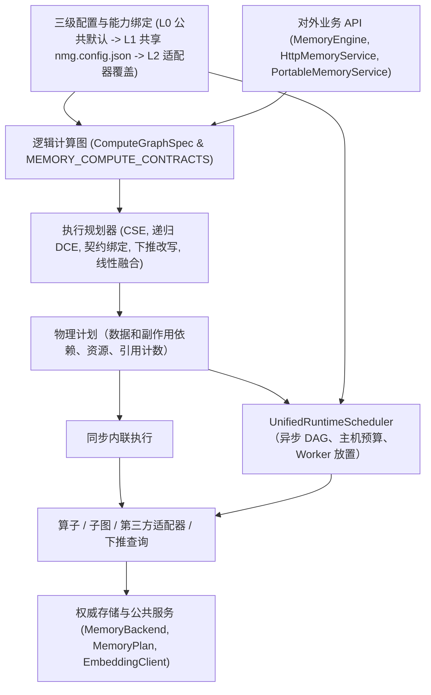

# 统一记忆计算引擎

[English](compute-engine.md) · [术语](compute-engine.terms.yaml)

**Status:** current
**Authority:** [统一架构](../unified-architecture.zh-CN.md)

## 分层执行边界

`MemoryEngine`、`HttpMemoryService` 与 `PortableMemoryService` 将业务契约与事务持久化同检索、重排、图投影、写入预处理及变更计划计算分离：

- **逻辑计算图（`ComputeGraphSpec`）**：使用 `src/core/compute-contracts.ts` 中的领域契约表达计算需求与数据流，不固化具体后端查询或执行顺序优化。
- `resolveEffectiveNmgConfig` 绑定 L0 公共默认值与已注册图配方、L1 共享配置、L2 宿主覆盖。`bindMemoryEngineConfig` 向引擎提供检索、视图、投影、写入和生命周期图。HTTP 子句融合、写入预处理和画像也读取同一份有效配置。能力绑定保留来源并参与结果身份。未获准的语义变体触发 `PolicyViolationError`。各层都按同一份声明式 schema 校验：未知分区、未知参数或类型不符会直接失败，不再静默沿用 L0 默认值。
- `PhysicalExecutionPlan` 解析 `$contract`，经由 `ComputeBackendRegistry`（`src/core/compute-lowering.ts`）将合格逻辑区域委托给对应后端，消除冗余或无用节点，并将合格的纯同步链与 DAG 编译为 V8 固定槽位闭包。`PLAN_CACHE` 按图身份、`ComputeRegistry` 实例令牌与代数、活跃后端适配器版本签名以及语义配置缓存物理计划。
- `executeComputeGraph` 将每个异步计划交给 `UnifiedRuntimeScheduler.executePlan`，子图递归进入同一就绪循环。`evaluateSyncComputeGraph` 在未传 memo 缓存与诊断器时走预编译的 `syncKernel` 快路径，其余情形回退至同步拓扑解释循环。两条路径共享算子、输入、缓存签名和输出生命周期规则。

## 后端优化委托与降级转换

`ComputeBackendRegistry`（`src/core/compute-lowering.ts`）将声明式后端能力（`supportedExprKinds`、`supportedOperations`、`boundaryConversionCostMs`）与匹配规则（`SQLITE_BACKEND_ADAPTER` `relational-v2`、`PORTABLE_BACKEND_ADAPTER` `portable-v1`、`JS_V8_BACKEND_ADAPTER` `v8-slot-v1`）从公共规划器分离：

- **凸区域校验与成本门控**：`isLegalConvexRegion` 校验单出口支配、DAG 凸性、无外部重入环及副作用／锁安全；`shouldApplyLowering` 仅在降级与转换成本之和不超过 `estimatedBaselineMs * optimization.costRatioThreshold` 时才委托。
- **SQLite 下推与便携等义回退**：合格算子与区域降级为 `src/core/memory/sqlite-relational.ts` 的单快照查询（`project_memories_with_topology`、`user_profile_query`、`lexical_search_page`、`ordered_get_page`、`profileEvidenceLinks` 与 UTC 偏移时间戳比较），其余情况经 `MemorySnapshotPort` 等义回退至 `portable_scan`。
- **JS/V8 同步优化**：`compileSyncPlanKernel` 将无锁纯同步 DAG 编译为固定槽位闭包，`compileFusedChainSyncRunner` 预绑定线性 `fused_chain`（无动态 `new Function`），`RerankCandidateIndex` 经 `WeakMap` 复用每批时间戳与索引（[决策记录](../../decisions/implemented/2026-11-26-backend-optimization-delegation-and-lowering.zh-CN.md)）。

## 运行策略与资源所有权

Node daemon 和 portable RPC 从 `NMG_CONFIG_PATH` 或服务数据目录读取 L1，项目 STG 使用同一解析器。本地 HTTP 从数据库目录读取 L1，并以该宿主配置的 `runtime` 或 `bindings` 作为 L2。Onlion 通过 `NMG_CAPABILITY_CONFIG` 接收同结构的 L1 JSON，在每个请求快照内建立空线程域的调度器，以维持 WASM SQLite 和嵌入句柄的请求生命周期。

| 配置 | 执行效果 |
| --- | --- |
| `runtime.profile` | 选择 `HostLoadGovernor` 的负载迟滞、后台并发、CPU 预算和 Worker 额度。 |
| `runtime.objective` | 选择内联与 Worker 之间的最早完成时间比较裕量。 |
| `runtime.maxWorkers` | 在主机额度和域容量内限制放置。零表示自动选取。线程按需创建，空闲后回收。 |
| `runtime.minOffloadCpuMs` | 算子在当前输入规模分桶的 CPU 估计低于该值时，保持内联。 |
| `runtime.maxConcurrentBackground` | 限制已准入的后台操作数，包含仍在等待服务 I/O 的操作。前台活跃时可将其收紧到一。 |
| `runtime.backgroundCpuBudgetMs` | 限制每 100 ms 准入窗口的后台 CPU 毫秒。纯同步片段和 Worker CPU 实测计费，Worker 准入到完成之间保留估计额度。 |
| `runtime.starvationMaxWaitMs` | 等待超时的后台任务按年龄排序，仍遵守资源和并发约束。 |
| `optimization.backend` | 选择委托后端目标（`auto`、`sqlite`、`portable`；环境变量 `NMG_OPTIMIZATION_BACKEND`）。 |
| `optimization.enableRegionLowering` | 启用将相邻关系算子折叠为单快照数据库查询。 |
| `optimization.enableLinearFusion` | 启用纯无资源同步算子的线性 `fused_chain` 融合。 |
| `optimization.enableSyncKernel` | 启用面向无锁同步 DAG 的 V8 槽位闭包编译。 |
| `optimization.costRatioThreshold` | 允许下推的最大 `(lowered + conversion) / baseline` 成本阈值。 |

物理策略独立于 `resultIdentityHash`，`PLAN_CACHE` 与 `ComputeMemoCache` 纳入活跃后端适配器版本及下推目标。`maintenance` 和 `stgSync` 保留兼容解析；声明驱动的 STG 合并使用 `stgConsolidation`。

就绪节点按前后台队列和关键路径排序。读写冲突的节点等待完整资源集合，期间不持有部分锁或执行槽。已获取的锁保留到操作实际完成，包括已经对调用者超时的写入。图失败会取消未启动的节点，等待已启动分支结束后再通知调用者关闭快照。动态嵌套任务如果在父任务持有命名锁时请求命名资源，会在准入时失败。普通子图由子节点自行申请资源。写计划状态属于单次变更，持久写入由存储层修订号检查和回执重放仲裁。

CPU 放置考虑就绪 CPU 工作量、调用端输入字节数、已观测通信开销和被选叶节点的可用性。获准的 Worker 算子与内联共用实现。较大的默认重排批次可以进入放置路径，小批次、替代图和不宜转移的数据仍可内联计算。Worker 失败向调用者传播，取消会终止正在运行的线程。

主机治理器采样系统 CPU 时间和进程事件循环压力，使用迟滞和后台事件循环让渡逐步恢复容量。队列／资源等待、同步线程 CPU、I/O 等待、Worker 排队与通信时间分别记账：声明 `execution: "async_io"` 的算子只把挂起墙钟时间记为等待（`ComputeCostModel.observeWait`），用于关键路径排序，不改写该算子的 CPU 估计。让渡后时间包含应用回调；任意同步 JavaScript 仍无法抢占。在途合并使用与 memo 作用域相同的节点签名和配置身份，因此只能在同一快照身份内共享工作，不会合并不同的逐请求快照。实测见[生产与合成对照](../../experiments/runtime/unified-runtime-convergence-2026-11-25.zh-CN.md)。

## 节点实现形态与渐进式能力声明

所有计算节点在同一套端口调用语义下支持五种可互换实现形态：

1. 注册在 `ComputeRegistry` 中的命名算子（`op: string`）。
2. 独立算法模块（通过 `registry.registerModule` 注册 `ComputeOperatorModule`）。
3. 递归嵌套子图（`node.subgraph` 或复合算子 `graphAsOperator`）。
4. 内联函数或第三方黑盒适配器（`node.fn` 或 `adaptExternalAlgorithm`）。
5. 可编译结构化表达式（`node.expression`，包括可下推至 SQLite 或便携扫描的 `relational_query`）。

算子通过 `ComputeRegisterOptions` 渐进式声明能力，并由 `resolveCapabilities` 按保守原则解析：

- **副作用类别（`ComputeEffectKind`）**：支持 `"pure"`、`"read"`、`"nondeterministic"`、`"write"`、`"opaque"`。缺省优化元数据的黑盒算子严格按 `"opaque"` 处理（禁止缓存、禁止并行、禁止重排、禁止死代码消除）。
- **缓存与状态安全边界**：
  - 写入和读取有界 LRU `ComputeMemoCache`（默认上限 512 条）的可变对象经 `structuredClone` 隔离，仅深冻结值（或显式 `immutableOutput`）直接复用；不可克隆对象自动跳过缓存。
  - 闭包函数身份通过显式 `COMPUTE_CACHE_TOKEN` 或 `WeakMap` 单调函数标识区分，不再仅依赖源码文本哈希。
  - 标记 `cacheable: true` 的 `"read"` 算子须在上下文中通过 `attachStateStamp` 携带所需外部依赖状态戳（`namespace`、`revision`／`snapshotId`、`modelVersion`、时钟）；缺少状态戳时安全退回不缓存。
  - 不可缓存、`"write"`、`"nondeterministic"` 与 `"opaque"` 节点生成独立污染标记并向全部下游节点传播；`SUBGRAPH_OPERATOR_META` 动态重算 `graphAsOperator` 复合能力与签名。
  - 物理执行器在下游引用计数归零后立即释放中间输出槽位。

## 生产计算图覆盖与模块依赖

生产路径通过窄快照端口（只读快照 `MemorySnapshotPort` 位于 `src/core/memory/hydration.ts`；未提交变更草稿 `MemoryPlan` 位于 `MemoryEngine.mutate` 内）执行计算图：

| 业务入口 | 生产计算图（`ComputeGraphSpec`） | 注册表与所属模块 |
| --- | --- | --- |
| 搜索与上下文组装 | `DEFAULT_ENGINE_SEARCH_GRAPH` | `ENGINE_SEARCH_REGISTRY`（`src/core/memory/search-compute-graph.ts`）；当混合检索 `limit > 80` 时冻结 `1..80` 名，并在 `81..100` 尾段补充相邻源轮次与 `same_state` 关系邻居 |
| 精确记录与图扩展读取 | `DEFAULT_GET_CONTEXT_GRAPH` | `ENGINE_VIEW_REGISTRY`（`src/core/memory/view-compute-graphs.ts`） |
| 有界邻域浏览 | `DEFAULT_NEIGHBORHOOD_GRAPH` | `ENGINE_VIEW_REGISTRY`（`src/core/memory/view-compute-graphs.ts`） |
| 多维关系图按需投影 | `DEFAULT_PROJECT_GRAPH` | `ENGINE_VIEW_REGISTRY`（`src/core/memory/view-compute-graphs.ts`） |
| 用户画像范围投影 | `DEFAULT_USER_PROFILE_GRAPH` | `ENGINE_VIEW_REGISTRY`（`src/core/memory/view-compute-graphs.ts`） |
| 批量写入变更计划 | `DEFAULT_REMEMBER_PLAN_GRAPH` | `ENGINE_WRITE_REGISTRY`（`src/core/memory/write-compute-graphs.ts`） |
| 生命周期与关系变更计划 | `DEFAULT_LIFECYCLE_PLAN_GRAPH` | `ENGINE_WRITE_REGISTRY`（`src/core/memory/write-compute-graphs.ts`） |
| 三段式因果重排 | `DEFAULT_PIECEWISE_RERANK_GRAPH` | `RERANK_COMPUTE_REGISTRY`（`src/core/memory/piecewise-rerank.ts`）；中段（`[6..20]`）对含至少两个不同时间戳的分组应用 `w_chrono_seq_pivot` |
| HTTP 多子句融合与拼页 | `DEFAULT_HTTP_SEARCH_GRAPH` | `HTTP_SEARCH_COMPUTE_REGISTRY`（`src/integration/http-search-graph.ts`）；与引擎搜索、`retrieval-graph.ts` 和 `PortableMemoryService` 共用 `src/core/memory/page-stitch-operators.ts` 中的双通道融合、按时间排序、尾段分数封顶（`capSupplementalTailScores`）与补齐拼页原语 |
| HTTP 写入对话预处理 | `DEFAULT_HTTP_WRITE_PREPROCESS_GRAPH` | `HTTP_WRITE_PREPROCESS_REGISTRY`（`src/integration/http-write-preprocess.ts`） |
| HTTP 画像摘要投影 | `DEFAULT_HTTP_PROFILE_GRAPH` | `HTTP_PROFILE_COMPUTE_REGISTRY`（`src/integration/http-profile-view.ts`） |

- **依赖方向护栏**：`tests/core/compute-architecture-guardrails.test.ts` 自动化校验核心计算层、规划器、领域计算图与读取视图模块零导入 SQLite、LanceDB 或 `MemoryEngine`，同时存储后端模块零导入计算层。
- **保留的事务耦合边界**：`MemoryEngine` 仅保留参数前置校验、只读快照打开／关闭生命周期及基于 `MemoryBackend.commit` 的乐观并发重试／凭据重放。写入图仅在 `MemoryPlan` 上生成未提交变更，不直接提交数据库事务。
- **入口**。CLI、daemon RPC 和 MCP 宿主适配器到达 `PortableMemoryService` 及 SQLite 或 LanceDB 引擎。WorkBuddy 和 DSH 在客户端复用召回、工作区和协调能力。本地 HTTP 和 Onlion 将检索交给 `HttpMemoryService`，Onlion 管理分区和待合并日志的可见性。`runGraphExperiments` 和解耦检索使用生产图执行器。OoO 的 Agent 任务调度负责会话、授权与任务提交生命周期。

## 算子接入规范与扩展边界

新增或评估算法时遵循以下规则：

1. 先检查 `src/core/compute-contracts.ts` 中的 `MEMORY_COMPUTE_CONTRACTS`，优先匹配或复用已有契约与中间结果，不在业务入口复制链路。
2. 明确区分**工程优化**（保持语义严格等价的 CSE、DCE、SQL 谓词下推、线性 `fused_chain` 融合，按输出一致性和延迟／内存指标验收）与**算法实验**（允许改变排序与召回结果的算子／配方变更，按冻结评测集与 `findParetoOptimalGraphs` 帕累托前沿验收）。
3. 当新实现完整覆盖旧实现时同步迁移调用方并清理废弃模块，不长期保留两套等价生产流程。
4. 可编译后端保持轻量局部演化：`relational_query` 直接下推给 SQLite 查询优化器（`SqliteMemoryBackend.projectMemories`）或便携扫描，稳定的同步纯链路可通过 `enableLinearFusion` 融合交由 V8 内联执行，无需引入重型编译器基础设施。
