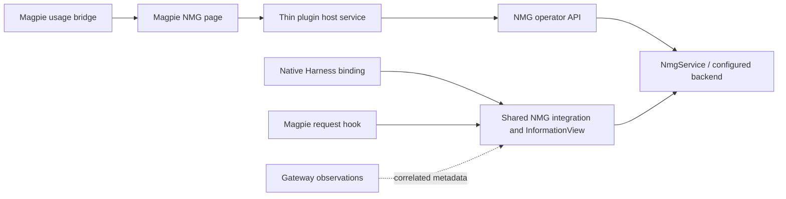

# Magpie operations panel and cooperation plan

[中文](magpie-operations.zh-CN.md) · [Terms](magpie-operations.terms.yaml)

**Status:** draft; implementation names and delivery slices can change.
**Authority:** [Magpie integration](magpie-integration.md).

## Intended first version

Use Magpie's window for an NMG page with store statistics, recall activity,
token accounting and embedding settings. Keep the memory service reusable by
other clients. Deliver the page before gateway recall: existing native NMG
users can use the page without changing their recall owner.

The proposed page has four areas:

| Area | Contents |
| --- | --- |
| Overview | Selected service/store/scope, connection health, memory/node/vector counts, physical storage, snapshot time |
| Activity | Automatic recall and explicit search separately; attempts, injections, empty/skipped/failed outcomes; period and source filters |
| Usage | Gateway-reported model usage, estimated injected context, NMG background model usage; coverage and unknown values |
| Embedding | Provider, embedding model, effective configuration source, masked credential status, candidate index and rebuild progress |

An indicative layout, without production values:

```text
NMG    Service / store / scope      Today | 7d | 30d
Memories —    Nodes —    Active-index vectors —    Storage —
Automatic recall: attempts — | injected — | skipped — | failed —
Explicit search: operations — | attempts — | empty — | failed —
Model tokens: reported —   Memory context: estimated —
Embedding: active model —  candidate —  index state —
[Connection] [Model settings] [Refresh]
```

## Ownership and supported host surface



The host service handles page transport and endpoint authentication. It does
not open another memory database, copy provider configuration files, or become
an Agent in the board roster. NMG owns store metrics, settings and indexing;
Magpie owns its gateway usage. A combined view retains both source labels.

Magpie `0.1.3545` was observed locally on 2026-11-12. Its
[versioned request-hook contract](https://github.com/yetone/magpie/blob/v0.1.3545/docs/subsystems/gateway-request-hooks.md)
is the initial implementation target, not proof of a working NMG binding.
Request hooks run before routing, retain state for one request and receive
selected metadata rather than client credentials. Completion callbacks are
best-effort observations.

The [versioned page contract](https://github.com/yetone/magpie/blob/v0.1.3545/internal/plugin/page.go) offers
declared bridge reads and an optional host service for an independent page.
It also supports panels in existing Usage, Agents, Settings and provider pages,
and provider/agent menu entries that open the plugin page. Panel transport needs
separate validation. A static page has no direct
network access. Custom NMG reads/settings therefore need a supported host
service or a separately validated upstream bridge extension. Do not invent an
unrestricted page RPC. The
[Nowledge Mem manifest](https://github.com/magpie-community/plugins/blob/main/packages/nowledge-mem/package.json)
shows a combined hooks/page/service package; it supplies a layout example, not
an NMG implementation dependency. A proposed `magpie-plugin/` can keep the
page, host transport and hooks together; packaging remains a validation item.

Use the [interface and adapter map](magpie-capabilities.md) to select the data
path. Aggregate usage comes from declared page bridge reads. An individual
request join uses caller tracing and validated OTLP export. The separate
synchronous `onUsage` observer has no session/request ID and cannot substitute
for that join or serve as the sole durable ledger.

## Metric meanings

All numbers carry their selected endpoint, physical store/namespace, scope,
period, snapshot time and measurement source. Scope-restricted counts use the
service's visibility rules. A backend-wide physical size must not appear as a
per-project logical size. Unsupported or missing measurements show unknown,
not zero. A disconnected view labels its last snapshot as stale.

Gateway-wide totals retain gateway-wide scope. A store filter does not relabel
or partition usage that has no verified store correlation. Whether bridge reads
and a custom service page can share one view is a target-host check; separate
panes are acceptable if the supported surface cannot combine them.

| Metric | Proposed definition and owner |
| --- | --- |
| Memory count | NMG-visible retrievable records; show historical/withdrawn/archived counts separately when available; distinguish LTG from authorized STG |
| Node count | Active semantic nodes in the same selected scope, not message or task counts |
| Vector count | Rows for the active model/profile/index, split into record, leaf and node vectors; old/candidate indexes and pending work are separate |
| Store size | Physical DB, WAL and auxiliary/vector files reported by their backend; show available components and incomplete coverage; namespace-attributed logical size is a different measure |
| Automatic recall | Shared lifecycle events distinguish eligibility checks, admitted attempts and successful injections, plus empty/skipped/failed results |
| Explicit search | Logical model/user search operations, with transport/internal retries counted separately; internal searches for automatic recall do not increment this number |
| Gateway model tokens | Provider-reported input/output and cache categories when available; preserve provider accounting semantics rather than adding overlapping categories |
| Injected context tokens | NMG rendered-context estimate, with tokenizer/model basis; it is not an exact share of the billed request |
| NMG background tokens | Embedding, summarization and judge operations by purpose; reported usage where supported, otherwise labelled estimates or unknown |
| Cost and reliability | Magpie cost estimates, errors, latency and missing-usage coverage; these do not replace a provider invoice or prove recall helped |

Period views need a bounded persistent NMG event/counter stream, not just
process-local counters. Events can carry operation IDs, request-attempt IDs,
source, outcome, duration, index/config revision and reported/estimated usage.
Only supported identifiers participate in deduplication. An event joins
gateway and NMG records only when a stable correlation key is available.
Otherwise show the observations separately. Do not add the same background
request again when it already appears in gateway totals.

A reasonable starting retention is 30 days of bounded metadata aggregates,
with explicit coverage start and gaps. This is adjustable. Opening the page
does not import past conversations. Existing traces can backfill a metric only
when their provenance and completeness support its definition. A gateway-only
source cannot count explicit tool operations that never pass through it.

NMG currently exposes service/embedding health and the main SQLite file size
through `status`; `embeddingIndexHealth` already separates indexed and pending
record/leaf/node work. Its process-local counters are not this complete usage
ledger. Counts, storage components, operator configuration and durable
classification need shared APIs/instrumentation rather than page-side SQL.
Use cached/batched snapshots with bounded refresh; do not run full table scans
for every UI poll. Portable backends report supported metrics explicitly.

## Embedding model and key settings

The page offers direct NMG embedding providers and a Magpie gateway route, with
a model ID and optional endpoint/profile. Magpie `0.1.3545` exposes
`/v1/embeddings` and `/v1/rerank`; the existing NMG OpenAI embedding client is
a concrete reuse candidate. Validate protocol compatibility and vector/index
identity before enabling it. Pin compatible provider/model routing so fallback
cannot mix vector spaces. A chat model list or the public `providers:list`
bridge does not supply an embedding-model catalog.

NMG owns its effective configuration and credential storage. For a gateway
route, store a restricted gateway credential while Magpie retains its upstream
vendor credentials. For a direct provider, NMG owns the provider credential.
The form submits a new key through an authenticated operator write, then clears it; later reads
return only configured/masked state. Plugin options hold nonsecret endpoint
and display settings, not an extra plaintext key copy. Key import from Magpie's
private files is not part of the design. The precise secure-storage mechanism
needs implementation selection. Keep operator settings outside model tools.

Existing environment-driven configuration is visible as such. An operator can
see which source wins before choosing a managed configuration; saving a form
must not silently claim to override a live environment value. Changes use an
expected configuration revision so two pages cannot overwrite each other.

Separate desired configuration, active configuration and index identity. A key
rotation alone need not rebuild compatible vectors. A changed model, profile
or dimension creates a candidate index. Show its scope, progress and estimated
work before the user starts it; retain the active index until the candidate is
ready and validated. Activation changes the reader/index generation together.
Failure keeps the usable prior index or the service's declared lexical mode.
Do not promise restart recovery or cancellation until the corresponding job
contract exists. Saving settings and testing an embedding request are separate
actions; connection tests do not send conversation text.

## Gateway and Harness cooperation

The useful addition is a combination of independent observations:

| Source | Contribution | Limit |
| --- | --- | --- |
| Native Harness | User-turn/tool boundaries, native session state, tool execution and exact disclosure receipts | Often lacks gateway routing and account-attempt details |
| Gateway platform | Available provider/model usage, fallback/retry outcomes, cache reports and request latency | Not all platform data is exposed to plugin hooks or bridge reads |
| NMG | Retrieved evidence, InformationView budgets, disclosure identity and index state | Does not infer correctness or useful memory from response success |

Use the [shared capability composition](harness-integration.md#compose-capabilities-across-connected-entry-points)
across all entry points connected to a session. Preserve capable native recall
paths and fill gaps with gateway preparation, MCP tools or other supported
providers. The page can show each capability's selected provider, coverage and
remaining gap. A composed flow needs trusted state handoff and one effect owner
per operation; independent caches or text hashes do not establish that join.

The [adapter map](magpie-capabilities.md#complement-existing-nmg-adapters)
targets NMG feature gaps in every adapter. Priorities include DSH/OpenCode state
carriage, WorkBuddy hook/tool continuity, missing shared tools and MCP automatic
recall. Usage, tracing and this GUI are independent enhancements; they do not
establish normal NMG feature coverage. Preserve existing native preparation.

Request hooks cannot assume the final routed provider is known before routing.
Start with configured bounded context, then use validated budget/usage hints
where available. A future feedback path can tune budgets from observed input,
cache and latency costs, but it does not by itself show better recall or saved
tokens. Magpie internal helper calls can bypass hooks; their classification and
usage coverage need separate host evidence.

Gateway in-flight traffic is request activity, not complete Agent busy/idle
state: tools can run between model requests. Keep its source label and combine
it with native/Agent reports only through supported contracts. The adapter is
not a persistent available worker. Hooks also do not create a second task board.

If NMG background model calls use Magpie, tag their purpose and prevent them
from re-entering automatic recall. This needs a host-supported exclusion or a
separate verified route; do not assume the hook receives arbitrary headers.
Without such an exclusion, the initial version keeps those calls outside the
recall hook path.

## Delivery order and acceptance

| Slice | Result | Acceptance before promotion |
| --- | --- | --- |
| 0: host contract | Pin Magpie/Bun, page/service loading, bridge reads and identity fields | Isolated target startup; page can reach only its configured authenticated service; record unavailable host fields |
| 1: read panel | Store snapshots, existing health, new durable recall/search counters and reported gateway usage | Counts match fixtures; unknown/stale/gaps are visible; reload/restart does not fabricate history; a retry is not a new user turn |
| 2: settings | Provider/model/key form, effective-source display and candidate-index activation | Masked reads; invalid/revision-conflicting settings fail; model generations never mix; failure preserves a usable mode |
| 3: NMG feature parity | Shared tools, recall/state carriage, attribution and request-time board delivery across bindings | Shared end-to-end cases per adapter, trusted handoff, tool continuations, duplicate suppression and cancellation; unsupported cases remain explicit |
| 4: optional capture | Separately enabled completion capture | Existing consent/source-time rules; partial/lost replies do not imply durable capture or positive feedback |

Slice 1 does not imply an admin configuration API already exists. Slices 1 and
2 form the initial GUI scope; gateway integration can follow without blocking
that work. Slice 3 covers [every adapter's NMG gaps](magpie-capabilities.md#complement-existing-nmg-adapters),
with MCP/gateway as one worked handoff. Function names, telemetry retention and refresh intervals remain
adjustable. Existing [gateway consent and identity rules](magpie-integration.md)
continue to apply. No plugin install, service upgrade, key change, index rebuild
or live model call was performed to write this plan.
