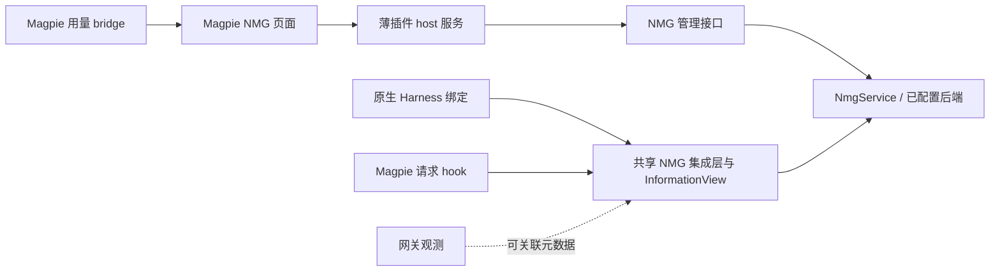

# Magpie 管理面板与联动计划

[English](magpie-operations.md) · [术语](magpie-operations.terms.yaml)

**Status:** draft；接口命名与交付切片可随实现调整。
**Authority:** [Magpie 集成](magpie-integration.zh-CN.md)。

## 首版目标

借用 Magpie 窗口提供 NMG 页面，包含库统计、召回活动、token 账本和向量设置。记忆服务保留供其他客户端复用的接口。建议先交付页面，再接网关自动召回；已有原生 NMG 插件的用户可以直接使用页面，无需更换召回所有者。

页面分为四个区域：

| 区域 | 内容 |
| --- | --- |
| 概览 | 当前服务／库／作用域、连接健康、记忆／节点／向量数量、物理占用和快照时间 |
| 活动 | 自动召回与主动搜索分别展示；尝试、注入、空结果／跳过／失败；按时间与来源筛选 |
| 用量 | 网关报告的模型用量、估算注入量、NMG 后台模型用量；覆盖范围与未知值 |
| 向量设置 | provider、向量模型、配置实际来源、脱敏凭据状态、候选索引与构建进度 |

界面草图，不使用生产数据：

```text
NMG    服务 / 储存库 / 作用域         今天 | 7天 | 30天
记忆 —    节点 —    当前索引向量 —    物理占用 —
自动召回：尝试 — | 已注入 — | 跳过 — | 失败 —
主动搜索：操作 — | 请求尝试 — | 空结果 — | 失败 —
模型 token：报告值 —   记忆上下文：估算值 —
向量：当前模型 —   待切换模型 —   索引状态 —
[连接设置] [模型设置] [刷新]
```

## 归属与宿主接口



Host 服务负责页面传输和端点认证，不另开记忆数据库、不复制供应商配置文件，也不作为 Agent 登记到黑板。库指标、配置和索引由 NMG 负责，网关用量由 Magpie 负责。组合展示保留两边的来源标签。

2026-11-12 在本机观察到 Magpie `0.1.3545`。[对应版本的请求 hook 合同](https://github.com/yetone/magpie/blob/v0.1.3545/docs/subsystems/gateway-request-hooks.md)作为首个实现目标，不表示 NMG 绑定已经可用。请求 hook 在路由前执行，只保留单次请求状态，接收部分元数据，不接收客户端凭据。完成回调是尽力观察。

[固定版本页面合同](https://github.com/yetone/magpie/blob/v0.1.3545/internal/plugin/page.go)提供声明过的 bridge 读取和独立页面的可选 host 服务，也支持在已有 Usage、Agents、Settings 和供应商页面嵌入面板，以及从供应商／Agent 菜单打开插件页。面板传输需要独立验证。静态插件页不能直接联网；自定义 NMG 读取和设置，需要受支持的 host 服务，或另行验证的上游 bridge 扩展，不能假设存在任意页面 RPC。[Nowledge Mem 清单](https://github.com/magpie-community/plugins/blob/main/packages/nowledge-mem/package.json)提供 hooks／page／service 同包的布局示例，不成为 NMG 实现依赖。拟议的 `magpie-plugin/` 可以将页面、host 传输与 hook 放在一起，打包方式仍需验证。

按[接口与适配器映射](magpie-capabilities.zh-CN.md)选择数据路径：聚合用量来自声明过的页面 bridge，单次请求关联使用调用方追踪和已验证的 OTLP 导出。独立的同步 `onUsage` 观察器没有 session／请求 ID，不能替代该关联，也不能单独承担持久账本。

## 统计口径

所有数值都带有所选端点、物理库／命名空间、作用域、时间范围、快照时间和测量来源。受作用域限制的数量使用服务既有可见性规则。整个后端的物理占用不能标成某项目的逻辑占用。不支持或缺失的数值显示未知，不显示零；断连时明确标出最后快照已过期。

全网关总量保留全网关作用域。库筛选不能重命名或分摊未验证库关联的用量。Bridge 读取能否与自定义 service 页面放在同一视图，是目标宿主验证项；受支持接口不能合并时可以分栏展示。

| 指标 | 建议含义与归属 |
| --- | --- |
| 记忆数量 | NMG 可见且具备检索资格的记录；可获得时另列历史／撤回／归档，区分 LTG 与获准的 STG |
| 节点数量 | 同一作用域内的活跃语义节点，不混入消息数或任务数 |
| 向量数量 | 当前模型／profile／索引的行数，拆分记录、叶块和节点向量；旧索引、候选索引与待处理量另列 |
| 储存库大小 | 后端报告的 DB、WAL、辅助／向量文件物理大小；显示可用组成和缺失范围，命名空间逻辑归属占用是另一种指标 |
| 自动召回 | 由共享生命周期区分资格检查、准入后的尝试和成功注入，以及空结果／跳过／失败 |
| 主动搜索 | 模型／用户发起的逻辑搜索操作；传输重试与内部重试另计，自动召回内部 search 不增加该数值 |
| 网关模型 token | 有报告时展示 provider 的输入／输出和缓存类别，保留各 provider 的统计含义，不把重叠类别相加 |
| 注入上下文 token | NMG 实际渲染上下文的估算量，标注 tokenizer／模型依据，不当成整次计费的精确分摊 |
| NMG 后台 token | 按 embedding、摘要和 judge 等用途区分；支持时用报告值，否则显示估算或未知 |
| 成本与可靠性 | Magpie 的成本估算、错误、延迟和用量缺失覆盖；不替代供应商账单，也不证明记忆有帮助 |

按时间段展示需要有界、持久化的 NMG 事件／计数流，不能只用进程内计数。事件可以携带操作 ID、请求尝试 ID、来源、结果、耗时、索引／配置修订，以及报告／估算用量。只有支持的身份参与去重。网关与 NMG 记录仅在存在稳定关联键时合并，否则分别展示。同一后台请求已经计入网关总量时，不再重复累加。

可从保留 30 天的有界元数据聚合开始，明确统计起点和缺口，保留调整余地。打开页面不导入过去的对话。既有 trace 只有在来源和完整性支持该定义时才用于回填；仅网关一侧无法统计完全绕过它的显式工具调用。

NMG 当前 `status` 已提供服务／embedding 健康及主 SQLite 文件大小，`embeddingIndexHealth` 已拆分记录／叶块／节点的已建和待建量。现有进程内计数不等于完整用量账本。数量、占用组成、管理配置和持久分类需要共享接口／埋点，不由页面执行 SQL。快照采用缓存／批量读取和有界刷新，避免每次 UI 轮询都全表扫描；可移植后端明确报告支持哪些指标。

## 向量模型和 key 设置

页面提供直连 NMG embedding provider 和 Magpie 网关路由，填写模型 ID 及可选端点／profile。Magpie `0.1.3545` 已暴露 `/v1/embeddings` 和 `/v1/rerank`，现有 NMG OpenAI embedding client 是具体复用候选。启用前验证协议兼容性和向量／索引身份，固定兼容的 provider/model 路由，防止 fallback 混入不同向量空间。聊天模型列表和公开 `providers:list` bridge 都不提供向量模型目录。

NMG 拥有自身有效配置和凭据存储。网关路由保存受限网关凭据，上游供应商凭据继续归 Magpie；直连 provider 的凭据归 NMG。表单通过认证的管理写入提交新 key 后清空，后续读取只返回已配置／脱敏状态。插件 options 保存非敏感端点和展示选项，不多存一份明文 key；不从 Magpie 私有文件导入 key。具体安全存储方式留待实现选定，管理设置不暴露为模型工具。

现有环境变量配置明确显示来源。操作方先看到哪一来源生效，再选择托管配置；保存表单不能静默宣称覆盖了正在生效的环境变量。变更携带期望配置修订，防止两页互相覆盖。

区分目标配置、当前生效配置和索引身份。单纯换 key 不必重建兼容向量；换模型、profile 或维度则创建候选索引。开始前展示范围、进度与工作量估计，候选就绪并验证前保留当前索引；激活时读者配置与索引代次一起切换。失败时保留可用旧索引，或使用服务声明的纯词法模式。重启恢复、取消等能力在有对应 job 合同前不作保证。保存设置与测试一次 embedding 请求是独立动作，连接测试不发送对话文本。

## 网关与 Harness 联动

有价值的是组合独立观测：

| 来源 | 能补充什么 | 限制 |
| --- | --- | --- |
| 原生 Harness | 用户回合／工具边界、原生会话状态、工具执行和精确披露收据 | 往往看不到网关路由和账号请求尝试 |
| 网关平台 | 可用的供应商／模型用量、fallback／重试结果、缓存报告和请求延迟 | 平台拥有的信息不一定都暴露给插件 hook 或 bridge |
| NMG | 检索证据、InformationView 预算、披露身份与索引状态 | 不从响应成功推断正确性或记忆有效 |

对会话全部已连接入口使用[共享能力组合](harness-integration.zh-CN.md#组合各接入点的能力)，保留可用的原生召回路径，用网关准备、MCP 工具或其他受支持提供方补缺。页面可展示各能力选定的提供方、覆盖与剩余缺口。组合流程需要可信状态交接，每个操作有一个效果所有者；独立缓存或文本哈希不能建立该关联。

[适配器映射](magpie-capabilities.zh-CN.md#与现有-nmg-适配器互补)面向每个适配器的 NMG 功能缺口，优先项包括 DSH／OpenCode 状态承载、WorkBuddy hook／工具接续、缺失的共享工具和 MCP 自动召回。用量、追踪和本 GUI 是独立增强，不构成正常 NMG 功能覆盖，已有原生准备路径继续保留。

请求 hook 不能假设路由前已经知道最终供应商。先采用配置过的有界上下文，再使用已验证的预算／用量提示。后续可以用输入、缓存和延迟成本调整预算，但这本身不证明召回变好或节省了 token。Magpie 的内部辅助调用可能绕过 hook，其分类和用量覆盖需要单独宿主证据。

网关在途流量表示请求活动，不等于完整 Agent 忙碌／空闲状态，模型请求之间可能还在运行工具。保留来源标签，仅通过支持的合同与原生／Agent 报告组合。适配器本身不是常驻可接单的 worker，hook 也不另建一套黑板。

NMG 后台模型调用若经过 Magpie，需要标注用途，并阻止它再次进入自动召回。使用宿主支持的排除机制或独立验证的路由，不能假设 hook 能读取任意请求头。缺少这种排除能力时，首版让这些调用避开召回 hook 路径。

## 交付顺序与验收

| 切片 | 结果 | 升为已交付前的验收 |
| --- | --- | --- |
| 0：宿主合同 | 固定 Magpie／Bun，验证页面／service 加载、bridge 与身份字段 | 隔离启动目标版本；页面只访问所配置的认证服务；记录宿主未提供的字段 |
| 1：只读面板 | 库快照、已有健康状态、新增持久召回／搜索计数及网关报告用量 | 数量与夹具一致；未知／过期／缺口可见；重载／重启不伪造历史；重试不算新用户回合 |
| 2：设置 | provider／模型／key 表单、配置有效来源、候选索引激活 | 读取脱敏；无效／修订冲突配置失败；模型代次不混用；失败保留可用模式 |
| 3：NMG 功能对齐 | 跨绑定共享工具、召回／状态承载、归因及请求时黑板投递 | 各适配器使用共享端到端用例，验证可信交接、工具续接、去重及取消；不支持情况明确保留 |
| 4：可选采集 | 单独启用完成采集 | 沿用同意与来源时间规则；部分／丢失回复不等于持久采集或正向反馈 |

切片 1 不表示管理配置 API 已存在。切片 1 和 2 构成首版 GUI，网关适配可以随后推进。切片 3 覆盖[每个适配器的 NMG 缺口](magpie-capabilities.zh-CN.md#与现有-nmg-适配器互补)，MCP／网关是其中一个交接示例。函数名、统计保留时间和刷新间隔都可调整。已有[网关同意与身份规则](magpie-integration.zh-CN.md)继续适用。编写本计划没有安装插件、升级服务、修改 key、重建索引或调用真实模型。
