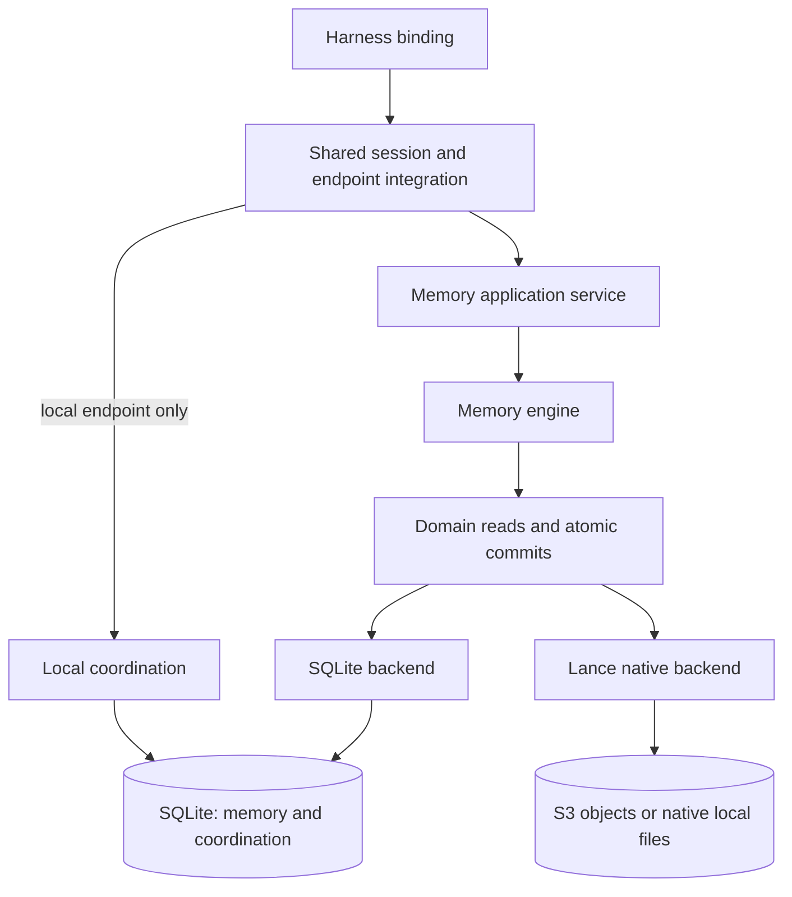

# Portable memory backends

[中文](native-backends.zh-CN.md) · [Terms used](native-backends.terms.yaml)

**Status:** current
**Authority:** [Unified architecture](../unified-architecture.md)

## Application boundary

`src/core/memory/engine.ts` owns admission, evidence, normalized duplicate detection,
state replacement, session visibility, graph links and bounded retrieval. It uses
the asynchronous `MemoryBackend` domain port. Transport, credentials and local
coordination stay outside that engine. The native backend dynamically loads
`@lancedb/lancedb` 0.41.0; the SQLite backend uses `node:sqlite`.



The explicit library entry is `NmgServiceOptions.memoryBackend`. An explicit
backend with a new namespace starts empty. Local CLI migration
installs existing SQLite data and selects it by default on reopen. Pure local
deployment shares one SQLite file between memory and coordination.

```typescript
import { NmgService } from "./src/cli/service.ts";

const service = new NmgService({
  databasePath: "./nmg.sqlite",
  memoryBackend: {
    kind: "sqlite",
    namespace: "trusted-tenant",
  },
});
try {
  await service.invoke("remember", {
    statement: "Atlas deploys in eu-west",
    nodeName: "Atlas",
    operationId: "trusted-stable-invocation-id",
  });
  console.log(await service.invoke("search", { query: "Atlas" }));
} finally {
  await service.close();
}
```

The service's SQLite backend defaults to `databasePath`; the optional backend
`path` is an explicit override. Separate interfaces and tables retain their own
ownership and transactions within the shared file. For object memory, select
`{ kind: "lancedb", uri: "s3://my-bucket/nmg", namespace: "trusted-tenant" }`;
coordination still uses the local SQLite file. A filesystem directory as the
Lance URI supports native local development. Supply S3 region/endpoint options
through `storageOptions` and credentials through the host's provider/environment.
The caller owns namespace authentication and authorization.
A namespace or session field is not an authentication mechanism.
Credentials never belong in model-authored tool arguments.

## Publication and retry

A commit carries entity upserts, its canonical request hash, expected revision,
operation ID and receipt. Domain entities include records, immutable evidence,
nodes and edges. The receipt and all changed entities become visible together.
Readers pin one published revision and must close their read view.

SQLite stores domain entities in normalized authoritative relational tables:
`nmg_sources`, `nmg_nodes`, `nmg_memories`, `nmg_memory_evidence`,
`nmg_memory_relations`, `nmg_memory_markers`, `nmg_tesserae`,
`nmg_state_aliases`, `nmg_write_events`, `nmg_relation_proposals`,
`nmg_claim_posteriors`, `nmg_claim_outcomes`, `nmg_resolution_events`, and
`nmg_receipts`, with schema revisions recorded in `nmg_schema_migrations`.
On first open of an unmigrated database containing `nmg_memory_entities`, a
single transaction imports all rows into the authoritative relational tables,
recovers missing primary evidence conservatively as `missing_recovered` empty
rows without fabricating original source text, verifies per-kind row counts, and
retires `nmg_memory_entities` via `DROP TABLE` (`openLocalMemory` writes a
verified `.before-unified-*.sqlite` backup before opening). SQLite uses a native
write transaction and independent WAL snapshot readers. Batch planning prefetches
bounded duplicate and node lookups from one revision. It indexes the batch's
changes in memory so later items see earlier changes in input order. Predecessor
lookups reuse the snapshot candidates for their scope, node and session. SQLite
groups relational upserts in the same commit. The contentless FTS5 projections for
memories (`nmg_memory_fts` / `nmg_memory_surface_fts`) and file references store
search terms, positions and document lengths for BM25 while authoritative text
lives in `nmg_memories` and `nmg_tesserae`. Withdrawal, forgetting markers, and
`quarantine`/`dormant` retention transitions immediately purge the memory's
FTS5 entries and vector rows (`nmg_memory_vectors` / `nmg_memory_vector_chunks`)
and demote linked relations. `rebuildDerivedIndexes()` rebuilds the derived FTS5
projections and prunes orphaned vectors directly from the authoritative
relational tables. A namespace/key registry (`nmg_memory_fts_rows`) maps records
to FTS rowids and is updated with the entities and projections. On first writable
open, older full-content indexes are replaced in one transaction using the exact
indexed text and existing rowids. Released SQLite pages are available for reuse.

Lance stores all domain entity kinds and receipts in one data table per namespace.
A write creates a shallow branch from the pinned version, applies one merge and
prepares native full-text indexes. A separate head table publishes the branch
and version through a conditional revision update. Only the winner publishes;
losers replan from the current head. Readers never query unpublished branches.
The object store must provide the conditional-write and consistency semantics
required by Lance's native S3 driver. Arbitrary S3-compatible services need their
own validation.

The same operation ID and hash replay the recorded response; different content
fails. The engine rechecks current memory availability before replaying a write
response, so withdrawal, supersession, forgetting or expiry can refuse replay.
Cancellation or a lost response does not imply rollback. Retry the same trusted
operation ID. Receipts have no automatic expiry in this format.

## Integration and limits

`HarnessConnection` accepts a host-owned endpoint and stable session/generation.
It binds session fields, derives write IDs from persisted invocation/slot identity,
checks advertised methods, propagates cancellation and rejects cloud coordination.
The host supplies authentication, transport and durable invocation checkpoints.
Closing a binding only fences that binding. Existing session recall/task flows
remain shared; Pi durable and Magpie bindings are separate work.

The local run coordinator consumes `CoordinationPort`, containing only board/run
operations and their transaction boundary. Its existing SQLite implementation
and tables remain authoritative. Portable memory operations do not initialize
coordination tables; explicit local board/run operations do. With SQLite memory,
both table groups share one file; with object memory, only coordination uses it.

This API supports remember/batch, search, exact get and withdrawal. `MemoryEngine`
also supports explicit node links and bounded graph expansion. The capability
handshake advertises the supported subset. SQLite stores one row per edge and
indexes its source and target separately. Neighbor reads merge the two
endpoint ranges by edge ID before applying the page limit.

Search supports explicit history, source actor and node filters. Attached file
references from a full SQLite snapshot are returned with visible memories. The
activated local SQLite profile also supports session AG, project recall,
versioned answer attribution, and
vector and hybrid retrieval. Its SQLite backend owns the model-keyed record
index plus candidate queries. The engine combines those candidates with full
text and applies visibility and graph rules. The host supplies embeddings.
Search resolves an explicit node name to IDs before selecting lexical and
vector candidates. SQLite stores vectors only for memory records. The engine
ranks visible candidates and loads the selected records' evidence from the
same snapshot.

Leaf context follows imported leaf memberships and records sharing the same
primary evidence. Peers stay in the seed's scope and obey the request's
visibility rules. Graph expansion can use leaf context to fill spare slots.
The compatibility values `hierarchy` and `union` under `vectorGranularity`
request bounded leaf context and can fill up to four spare result slots. Both
also work with lexical search. A database upgrade preserves existing
memberships and releases the obsolete node and leaf vector pages for reuse.

An explicit local search in the default mode can end at lexical retrieval when
its only query is a standalone identifier or quoted phrase and a visible
statement contains the complete anchor. The normal scope and visibility rules
apply. An anchor miss follows the usual retrieval path. Requests with a
selected retrieval mode, alternate queries, or automatic recall use their
existing retrieval path.
SQLite selects one ordered page of missing vectors before fetching previous turns
by session and source sequence. A memory write or semantic search can schedule
a sweep per local index and model. The daemon advances by creation time and
ID and yields between batches so it can serve incoming requests. Provider
concurrency stays bounded by the shared embedding transport. Vector saves check
that the record is indexable and its statement matches the submitted text.
If the provider fails or the service is explicitly stopped, unfinished rows
remain eligible on reopening.
The [local compatibility profile](legacy-graph-migration.md#local-default-after-activation)
also owns event-time windows, lifecycle writes, feedback, bookmark lookup and
existing chain projection. Chain editing and node transforms retain separate
migration gates. Native Worker/WASM deployment and the cloud interactive API
remain separate work.

The [legacy graph migration rehearsal](legacy-graph-migration.md) compares the
two paths and exercises a bounded import into either backend.

Native branches and receipts are retained; automatic compaction, unreachable
branch collection and retention administration require a separate maintenance
contract. FTS is prepared on each memory commit, so small frequent writes and many
namespaces require cost measurements before production adoption. SQLite and
Lance may rank candidates differently. Search bounds candidates and graph fanout;
it does not establish recall completeness over a large filtered corpus.

## Verification boundary

The backend and engine contract tests exercise both implementations. Native S3
tests use real Lance HTTP object access against an in-process protocol fixture,
including conditional publication, concurrency, reopening and failed writes.
That fixture is not an AWS authentication, durability or production S3 test.
Current evidence and unverified deployment gates belong in the
[completion audit](../completion-audit.md#portable-memory-backend-slice).
