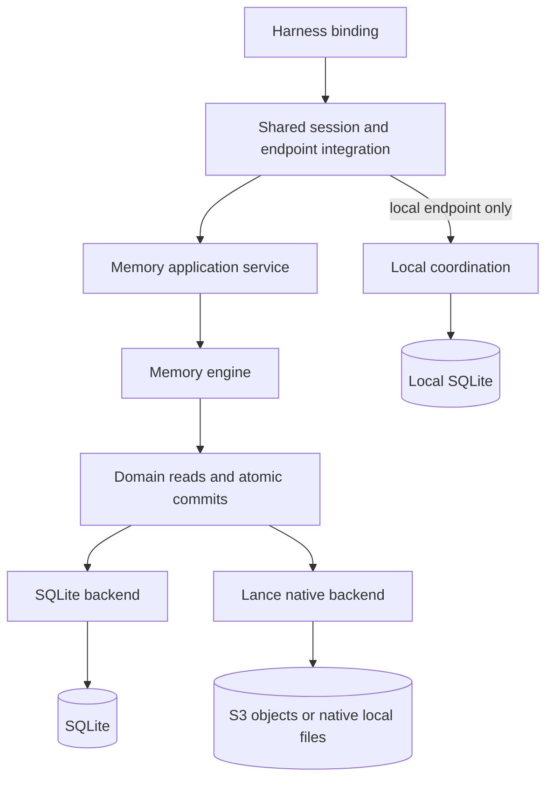

# Portable memory backends

[中文](native-backends.zh-CN.md) · [Terms used](native-backends.terms.yaml)

**Status:** current
**Authority:** [Unified architecture](../unified-architecture.md)

## Application boundary

`src/core/memory/engine.ts` owns admission, evidence, normalized duplicate detection,
state replacement, session visibility, graph links and bounded retrieval. It uses
the asynchronous `MemoryBackend` domain port. Transport, credentials and local
coordination stay outside that engine. The native backend dynamically loads
`@lancedb/lancedb` 0.41.0; the SQLite backend uses `node:sqlite`.



The explicit library entry is `NmgServiceOptions.memoryBackend`. Omitting it keeps
the existing memory path. It is not selected by a CLI flag or a model parameter.
Use a new namespace/location; existing databases are not imported or converted.

```typescript
import { NmgService } from "./src/cli/service.ts";

const service = new NmgService({
  databasePath: "./coordination.sqlite",
  memoryBackend: {
    kind: "lancedb",
    uri: "s3://my-bucket/nmg",
    namespace: "trusted-tenant",
    storageOptions: {
      aws_region: "us-east-1",
      // Supply credentials through the host's credential provider/environment.
    },
  },
});
try {
  await service.invoke("remember", {
    statement: "Atlas deploys in eu-west",
    nodeName: "Atlas",
    operationId: "trusted-stable-invocation-id",
  });
  console.log(await service.invoke("search", { query: "Atlas" }));
} finally {
  await service.close();
}
```

Choose `{ kind: "sqlite", path: "./memory.sqlite", namespace: "trusted-tenant" }`
for the parallel SQLite implementation, or a filesystem directory as the Lance
URI for native local development. The caller owns namespace authentication and
authorization. A namespace or session field is not an authentication mechanism.
Credentials never belong in model-authored tool arguments.

## Publication and retry

A commit carries entity upserts, its canonical request hash, expected revision,
operation ID and receipt. Domain entities include records, immutable evidence,
nodes and edges. The receipt and all changed entities become visible together.
Readers pin one published revision and must close their read view.

SQLite uses a native write transaction and independent WAL snapshot readers.
Lance stores all domain entity kinds and receipts in one data table per namespace.
A write creates a shallow branch from the pinned version, applies one merge and
prepares native full-text indexes. A separate head table publishes the branch
and version through a conditional revision update. Only the winner publishes;
losers replan from the current head. Readers never query unpublished branches.
The object store must provide the conditional-write and consistency semantics
required by Lance's native S3 driver. Arbitrary S3-compatible services need their
own validation.

The same operation ID and hash replay the recorded response; different content
fails. The engine rechecks current memory availability before replaying a write
response, so withdrawal, supersession, forgetting or expiry can refuse replay.
Cancellation or a lost response does not imply rollback. Retry the same trusted
operation ID. Receipts have no automatic expiry in this format.

## Integration and limits

`HarnessConnection` accepts a host-owned endpoint and stable session/generation.
It binds session fields, derives write IDs from persisted invocation/slot identity,
checks advertised methods, propagates cancellation and rejects cloud coordination.
The host supplies authentication, transport and durable invocation checkpoints.
Closing a binding only fences that binding. Existing session recall/task flows
remain shared; Pi durable and Magpie bindings are separate work.

The local run coordinator consumes `CoordinationPort`, containing only board/run
operations and their transaction boundary. Its existing SQLite implementation
and tables remain authoritative. Portable memory operations do not open that
database; explicit local board/run operations do.

This API supports remember/batch, search, exact get and withdrawal. `MemoryEngine`
also supports explicit node links and bounded graph expansion. The capability
handshake advertises the supported subset. Session AG, chains, file tesserae,
vector retrieval, historical queries, merge/split, feedback and advanced filters
are not supplied by this profile; unsupported service operations fail explicitly.
No automatic migration, cloud interactive API or native Worker/WASM deployment
is provided. The existing AML/snapshot path is unchanged.

Native branches and receipts are retained; automatic compaction, unreachable
branch collection and retention administration require a separate maintenance
contract. FTS is prepared on each memory commit, so small frequent writes and many
namespaces require cost measurements before production adoption. SQLite and
Lance may rank candidates differently. Search bounds candidates and graph fanout;
it does not establish recall completeness over a large filtered corpus.

## Verification boundary

The backend and engine contract tests exercise both implementations. Native S3
tests use real Lance HTTP object access against an in-process protocol fixture,
including conditional publication, concurrency, reopening and failed writes.
That fixture is not an AWS authentication, durability or production S3 test.
Current evidence and unverified deployment gates belong in the
[completion audit](../completion-audit.md#portable-memory-backend-slice).
