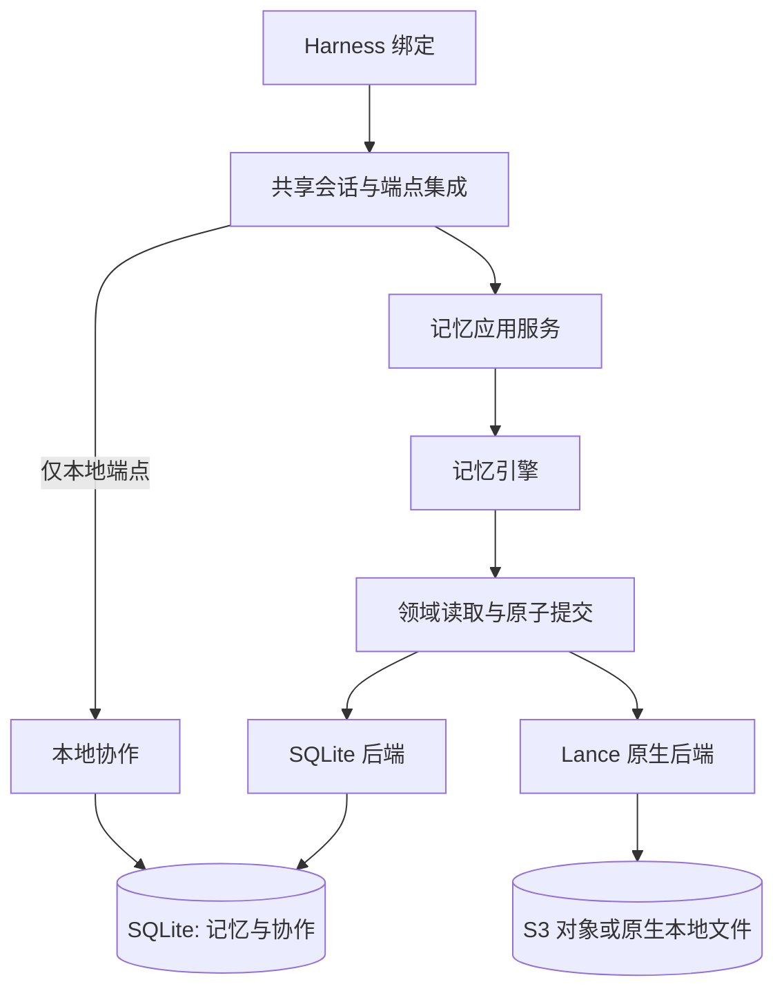

# 可替换记忆后端

[English](native-backends.md) · [术语](native-backends.terms.yaml)

**Status:** current
**Authority:** [统一架构](../unified-architecture.zh-CN.md)

## 应用边界

`src/core/memory/engine.ts` 负责准入、证据、规范化精确去重、状态替换、会话可见性、图关系和有界检索，通过异步 `MemoryBackend` 领域接口读写。传输、凭据和本地协作由引擎之外的组件负责。原生后端动态加载 `@lancedb/lancedb` 0.41.0；SQLite 后端使用 `node:sqlite`。



显式库入口是 `NmgServiceOptions.memoryBackend`。省略时沿用既有记忆路径；不通过 CLI 开关或模型参数选择。使用新的记忆命名空间，既有记忆数据不会被导入或转换。纯本地部署中，记忆与协作共用一个 SQLite 文件。

```typescript
import { NmgService } from "./src/cli/service.ts";

const service = new NmgService({
  databasePath: "./nmg.sqlite",
  memoryBackend: {
    kind: "sqlite",
    namespace: "trusted-tenant",
  },
});
try {
  await service.invoke("remember", {
    statement: "Atlas deploys in eu-west",
    nodeName: "Atlas",
    operationId: "trusted-stable-invocation-id",
  });
  console.log(await service.invoke("search", { query: "Atlas" }));
} finally {
  await service.close();
}
```

服务的 SQLite 后端默认使用 `databasePath`，后端的可选 `path` 是显式覆盖配置。同一文件内，记忆与协作仍分别拥有接口、表和事务。对象记忆选择 `{ kind: "lancedb", uri: "s3://my-bucket/nmg", namespace: "trusted-tenant" }`，协作仍使用本地 SQLite 文件。Lance URI 也可使用本地目录以便开发。通过 `storageOptions` 提供 S3 区域／端点选项，凭据由宿主提供方或环境提供。调用方负责命名空间认证和授权，命名空间或会话字段本身不是认证机制。凭据不得放入模型生成的工具参数。

## 发布与重试

提交包含实体更新、规范化请求哈希、期望版本、操作 ID 和凭据。领域实体包括记忆记录、不可变证据、节点和边。凭据与全部实体变更一起可见。读取固定一个已发布版本，使用后必须关闭读取视图。

SQLite 使用原生写事务和独立 WAL 快照读取。Lance 每个命名空间使用一张数据表保存所有领域实体和凭据。写入从固定版本建立浅分支，执行一次合并并准备原生全文索引；独立的 head 表通过带版本条件的更新发布分支和版本。只有竞争获胜者能发布，其他写者从最新 head 重新规划。读者不查询未发布分支。对象存储须满足 Lance 原生 S3 驱动要求的条件写入和一致性语义；其他 S3 兼容服务须单独验证。

相同操作 ID 和哈希重放已记录响应，不同内容报错。引擎在重放写入响应前检查记忆当前可用性，删除、替换、遗忘或过期都可能拒绝重放。取消或响应丢失不代表回滚；重试必须使用相同的可信操作 ID。此格式中的凭据不自动过期。

## 集成与限制

`HarnessConnection` 接收宿主拥有的端点及稳定会话／generation，绑定会话字段，从已持久化的 invocation／slot 标识派生写入 ID，检查端点公布的方法、传递取消信号，并拒绝云端协作。宿主提供认证、传输和持久化调用检查点。关闭绑定只约束该绑定。既有会话召回和任务流程继续共享；Pi durable、Magpie 绑定另行接入。

本地 run 协调器依赖 `CoordinationPort`，其中仅包含 board／run 操作和事务边界。既有 SQLite 实现和表仍是权威来源。可替换记忆操作不初始化协作表，显式的本地 board／run 操作才会初始化。使用 SQLite 记忆时，两组表共用一个文件；使用对象记忆时，仅协作使用该文件。

此 API 支持 remember／batch、search、精确 get 和删除。`MemoryEngine` 还支持显式节点连边和有界图扩展。能力握手公布支持的子集。此配置不提供会话 AG、chain、文件 tesserae、向量检索、历史查询、merge／split、反馈和高级过滤；不支持的服务操作会明确报错。不提供自动迁移、云端交互 API 或原生 Worker／WASM 部署。既有 AML／快照路径不变。

原生分支和凭据保留；自动压缩、不可达分支回收和保留期管理需要独立维护契约。每次记忆提交都会准备全文索引，小批高频写入与大量命名空间须先测量成本再用于生产。SQLite 与 Lance 可以有不同候选排序。检索限制候选和图扇出，不保证大型过滤语料上的完整召回。

## 验证边界

后端和引擎契约测试覆盖两套实现。原生 S3 测试通过真实 Lance HTTP 对象访问连接进程内协议夹具，覆盖条件发布、并发、重开和写入失败。该夹具不证明 AWS 认证、持久性或生产 S3 行为。当前证据及未验证部署门槛见[完成度审计](../completion-audit.zh-CN.md#可替换记忆后端切片)。
