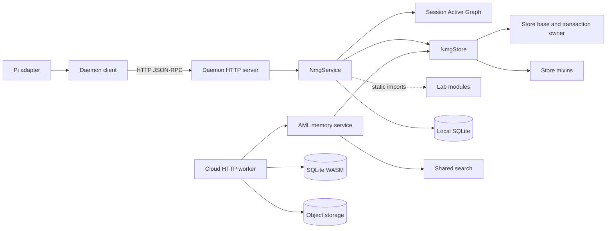

# Architecture boundary baseline — 2026-10-27

[中文](architecture-baseline-2026-10-27.zh-CN.md) · [Terms used](architecture-baseline-2026-10-27.terms.yaml)

This scoped review gives a starting point for comparing four architecture boundaries. The initial review examined revision `f8e2995eaa658d3f6806f7430d6989cade392a24`. The measurements below use `8fe7bfa3eee359a3b75d54515ebfcf5aec59270d`, selected earlier revisions, and two executed test files. They do not establish an overall historical trend. `Watch` means a question merits investigation, not that a defect is proven. `Unknown` means the review did not establish the answer.

## Observed architecture

The arrows show selected source dependencies or calls, not a complete runtime graph. The cloud path uses shared store and search primitives directly; it does not pass through the local daemon.



Sources: [Pi adapter](../../.pi/extensions/nmg/index.ts), [daemon client](../../src/cli/daemon-client.ts), [HTTP server](../../src/cli/http-server.ts), [service](../../src/cli/service.ts), [store composition](../../src/core/store.ts), and [cloud worker](../../onlion/backend/worker.mjs) with its [memory service](../../onlion/backend/memory-service.ts). The SQLite nodes identify the different execution contexts, not two independent store implementations.

| Boundary | Status and evidence | Question for the next review |
| --- | --- | --- |
| Store / Task Board | **Watch.** [`NmgStoreBase`](../../src/core/store/base.ts) owns write transaction coordination and Task Board operations. The source rejects a second transaction and asynchronous transaction callbacks. This shared boundary constrains any split. | For a representative Board change, which files and tests change? Can ownership be separated while preserving the same connection and transaction semantics? |
| Lite / Lab | **Watch.** The [design](../design/design.md) distinguishes default Lite from opt-in Lab. [`NmgService`](../../src/cli/service.ts) statically imports several Lab modules; the import alone does not establish a default-path failure or policy violation. | What Lab code loads on the default path, and do a missing dependency or a Lab initialization failure affect Lite? |
| Local / cloud | **Watch.** [Onlion](../../onlion/README.md) imports the shared implementation and documents different SQLite and object-storage environments. It describes Miniflare with simulated R2 and separate real-bucket checks; this review did not run them. | Which common cases prove scope isolation, concurrent writes, retries and recovery on each adapter, and which environments remain untested? |
| Adapter / core | **Watch.** The [shared-session decision](../decisions/implemented/2026-10-16-shared-session-flows.md) describes extracting shared flows from Pi; other adapters continue to have their own entrypoints. This review did not compare their full call paths. | For one representative session flow, what must a new adapter implement or change in core, and where do adapter behaviors diverge? |

## Comparison and limits

### Source measurements

The unit is a physical line, including blank lines. Counts use tracked file contents at each revision. Direct import counts are distinct module specifiers matched in static `from` and side-effect `import` clauses, including type-only imports; they are not a transitive dependency graph. The two earlier revisions are selected points, not a continuous time series.

| Source | 2026-10-16 `4800da7a` lines / direct imports | 2026-10-27 `c7306caf` lines / direct imports | 2026-10-27 `8fe7bfa3` lines / direct imports |
| --- | --- | --- | --- |
| `src/cli/service.ts` | 4,072 / 33 | 4,286 / 36 | 4,286 / 36 |
| `src/core/store/base.ts` | 2,974 / 22 | 3,059 / 23 | 3,059 / 23 |
| `src/core/store/retrieval.ts` | 2,366 / 17 | 2,372 / 17 | 2,372 / 17 |
| `src/core/store/maintenance.ts` | 2,587 / 16 | 2,605 / 16 | 2,605 / 16 |

`service.ts` has four distinct direct `../lab/` imports at each point. Counts indicate size and direct fan-out, not active feature use, coupling strength, or defects. These physical-line counts replace the earlier PowerShell counts, whose method did not give the same line definition.

To reproduce both counts, run the following Python from the repository root, changing `revisions` and `paths` as needed. This text scan can include commented-out imports; inspect any changed count before interpreting it.

```python
import re, subprocess
revisions = ["4800da7a", "c7306caf", "8fe7bfa3"]
paths = ["src/cli/service.ts", "src/core/store/base.ts",
         "src/core/store/retrieval.ts", "src/core/store/maintenance.ts"]
pattern = r"\bfrom\s+['\"]([^'\"]+)['\"]|\bimport\s*['\"]([^'\"]+)['\"]"
for revision in revisions:
    for path in paths:
        source = subprocess.check_output(["git", "show", f"{revision}:{path}"], text=True, encoding="utf-8")
        modules = {a or b for a, b in re.findall(pattern, source)}
        assert source and modules
        print(revision, path, len(source.splitlines()), len(modules))
```

### Transaction test measurement

At `8fe7bfa3`, on Windows with Node `v24.19.0`, `node --experimental-strip-types --test tests/core/store/task-runs.test.ts tests/integration/ooo-managed-write.test.ts` passed **15/15 tests**, with Node reporting **656.6 ms** total. The selected tests include a board transition and run fact committing together, and rollback when a coordinated write fails. One local run is not a performance benchmark or proof of cloud behavior. Compare the same command, Node version, OS and environment; record each run rather than assuming this duration is a threshold.

The inspected history includes shared-session extraction (`4800da7a`) and information-view unification (`c7306caf`), alongside the EdgeOne adapter (`890de371`). These show both consolidation and scope growth. They do not prove that overall architecture improved or deteriorated. The next useful comparison is a named change scenario with affected files, contracts, tests, verification time and unresolved failure cases, measured with the same boundaries before and after a change.

This record is observation, not a standing rule or a proposal to split modules. The [system design](../design/design.md) owns contracts; the [completion audit](../design/completion-audit.md) owns implementation evidence. Any current claims must be checked again against the selected revision.
