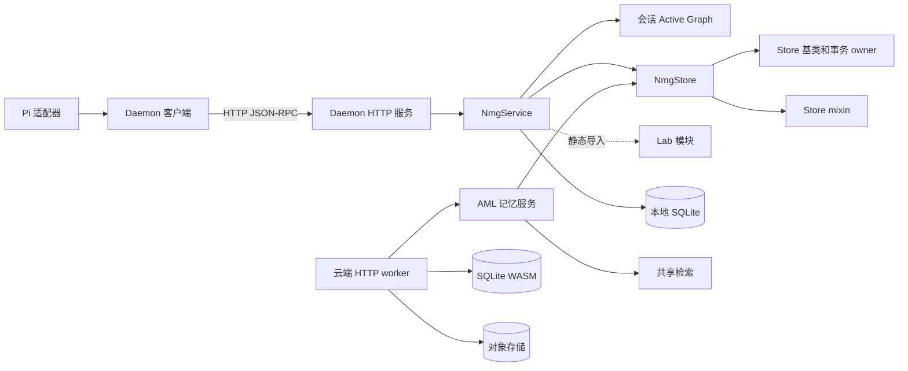

# 架构边界基线——2026-10-27

[English](architecture-baseline-2026-10-27.md) · [术语](architecture-baseline-2026-10-27.terms.yaml)

这次有范围的审阅为四个架构边界提供比较起点。初次审阅对象是版本 `f8e2995eaa658d3f6806f7430d6989cade392a24`；下方测量使用 `8fe7bfa3eee359a3b75d54515ebfcf5aec59270d`、选定的历史版本和实际运行的两个测试文件。这些数据不能证明整体历史趋势。“关注”表示问题值得调查，不表示缺陷已被证实；“未知”表示本次审阅没有得出答案。

## 实际架构图

箭头表示已选取的源码依赖或调用，不是完整运行时调用图。云端路径直接使用共享存储和检索组件，不经过本地 daemon。



依据：[Pi 适配器](../../.pi/extensions/nmg/index.ts)、[daemon 客户端](../../src/cli/daemon-client.ts)、[HTTP 服务](../../src/cli/http-server.ts)、[服务](../../src/cli/service.ts)、[Store 组合](../../src/core/store.ts)、[云端 worker](../../onlion/backend/worker.mjs)及其[记忆服务](../../onlion/backend/memory-service.ts)。两个 SQLite 节点表示不同执行环境，不表示存在两套独立 Store 实现。

| 边界 | 状态和证据 | 下次审阅要回答的问题 |
| --- | --- | --- |
| Store / Task Board | **关注。** [`NmgStoreBase`](../../src/core/store/base.ts) 负责写事务协调和 Task Board 操作。源码拒绝第二个事务和异步事务回调；共享边界会约束拆分。 | 选一个有代表性的 Board 修改，需要改哪些文件、运行哪些测试？能否在保留同一连接与事务语义的前提下分离职责？ |
| Lite / Lab | **关注。** [设计](../design/design.zh-CN.md)区分默认 Lite 与按需启用的 Lab。[`NmgService`](../../src/cli/service.ts) 静态导入多个 Lab 模块；仅凭导入不能认定默认路径故障或违反策略。 | 默认路径会加载哪些 Lab 代码？缺失依赖或 Lab 初始化失败是否影响 Lite？ |
| 本地 / 云端 | **关注。** [Onlion](../../onlion/README.zh-CN.md) 导入共享实现，文档列出不同的 SQLite 与对象存储环境，也描述了模拟 R2 的 Miniflare 测试和独立的真实桶检查；本次没有运行它们。 | 每个适配器有哪些共同用例验证作用域隔离、并发写入、重试和恢复？哪些环境没有覆盖？ |
| Adapter / Core | **关注。** [共享会话决策](../decisions/implemented/2026-10-16-shared-session-flows.zh-CN.md)描述了从 Pi 提取共享流程；其他适配器仍有各自入口。本次没有比较完整调用路径。 | 选一个有代表性的会话流程，新增适配器需要实现什么、修改哪些核心代码？各适配器行为在哪里不同？ |

## 比较与限制

### 源码测量

统计单位为包含空行的物理行，数据取自各版本的 Git 跟踪文件。直接导入数是静态 `from` 与副作用 `import` 中不同模块路径的数量，包含仅用于类型的导入；它不是传递依赖图。两个历史版本只是选取的时间点，不是连续时间序列。

| 源码 | 2026-10-16 `4800da7a` 行数 / 直接导入数 | 2026-10-27 `c7306caf` 行数 / 直接导入数 | 2026-10-27 `8fe7bfa3` 行数 / 直接导入数 |
| --- | --- | --- | --- |
| `src/cli/service.ts` | 4,072 / 33 | 4,286 / 36 | 4,286 / 36 |
| `src/core/store/base.ts` | 2,974 / 22 | 3,059 / 23 | 3,059 / 23 |
| `src/core/store/retrieval.ts` | 2,366 / 17 | 2,372 / 17 | 2,372 / 17 |
| `src/core/store/maintenance.ts` | 2,587 / 16 | 2,605 / 16 | 2,605 / 16 |

三个时间点的 `service.ts` 均有 4 个不同的 `../lab/` 直接导入。数量反映规模和直接依赖面，不能说明功能是否启用、耦合强度或缺陷。这些物理行数替代先前的 PowerShell 数字，两者的行数定义不同。

在仓库根目录运行以下 Python 可复现两项统计，按需修改 `revisions` 和 `paths`。文本扫描可能包含被注释的导入；解释变化前应检查具体路径。

```python
import re, subprocess
revisions = ["4800da7a", "c7306caf", "8fe7bfa3"]
paths = ["src/cli/service.ts", "src/core/store/base.ts",
         "src/core/store/retrieval.ts", "src/core/store/maintenance.ts"]
pattern = r"\bfrom\s+['\"]([^'\"]+)['\"]|\bimport\s*['\"]([^'\"]+)['\"]"
for revision in revisions:
    for path in paths:
        source = subprocess.check_output(["git", "show", f"{revision}:{path}"], text=True, encoding="utf-8")
        modules = {a or b for a, b in re.findall(pattern, source)}
        assert source and modules
        print(revision, path, len(source.splitlines()), len(modules))
```

### 事务测试测量

在 `8fe7bfa3`，使用 Windows 和 Node `v24.19.0` 执行 `node --experimental-strip-types --test tests/core/store/task-runs.test.ts tests/integration/ooo-managed-write.test.ts`：**15/15 项通过**，Node 报告总耗时 **656.6 毫秒**。这些测试包括 Board 转换和 run fact 一同提交，以及协调写入失败时共同回滚。一次本地运行不是性能基准，也不能证明云端行为。后续比较应使用相同命令、Node 版本、操作系统与环境并记录每次结果，不把这个耗时当作阈值。

审阅过的历史包括共享会话流程提取（`4800da7a`）、信息视图统一（`c7306caf`）和 EdgeOne 适配器（`890de371`）。它们分别显示了收敛和范围扩张，但不能证明整体架构改善或恶化。下一次有价值的比较是选定一个修改场景，在变更前后以相同边界记录受影响文件、契约、测试、验证时间和未解决的失败场景。

本记录是观察，不是常驻规则或拆分模块的决定。[系统设计](../design/design.zh-CN.md)拥有契约；[完成审计](../design/completion-audit.zh-CN.md)拥有实现证据。引用当前状态时，应重新核对选定版本。
