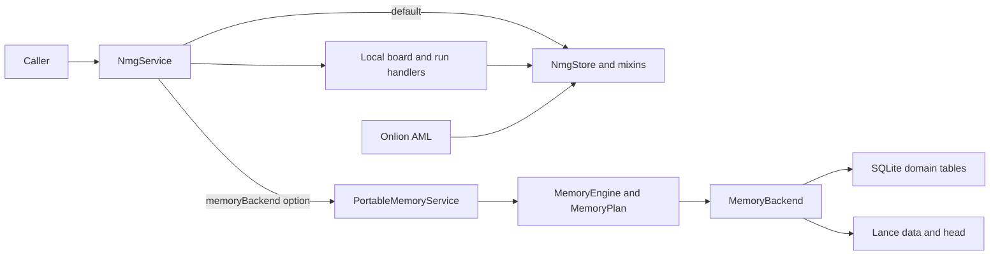

# Dependency boundaries and memory paths — 2026-11-14

[中文](architecture-dependency-and-memory-2026-11-14.zh-CN.md) · [Terms used](architecture-dependency-and-memory-2026-11-14.terms.yaml)

This measurement covers revision `aa125ae541ae69999bea79b0c9552de520874f81` on Windows with Node `v26.13.0`. It extends the historical [architecture baseline](architecture-baseline-2026-10-27.md). It records source observations and selected test results, not a new dependency rule or evidence that either memory path is production-equivalent to the other. The [unified architecture](../design/unified-architecture.md) owns the accepted direction.

## Import matrix

The [reproducible probe](architecture-import-matrix-2026-11-14.mjs) ran at 2026-11-14 12:24:26 UTC. It read **192 tracked TypeScript files under `src/`** and found **194 cross-group relative references**. Rows are importers; columns are referenced groups. A number counts source declarations/calls, not unique target files: two declarations importing the same module count twice. `—` excludes within-group references; `0` means none found under this method.

| From / to | core | integration | cli | lab | rcp | prompts |
| --- | ---: | ---: | ---: | ---: | ---: | ---: |
| core | — | 3 | 0 | 1 | 0 | 0 |
| integration | 63 | — | 9 | 4 | 0 | 2 |
| cli | 33 | 22 | — | 5 | 0 | 0 |
| lab | 9 | 0 | 0 | — | 0 | 0 |
| rcp | 0 | 0 | 0 | 0 | — | 0 |
| prompts | 0 | 0 | 0 | 0 | 0 | — |
| `src/index.ts` | 18 | 24 | 1 | 0 | 0 | 0 |

The probe uses the existing TypeScript import extractor plus `import("...")` type queries. It counts literal import/export declarations, import-equals, `require()` and dynamic imports, including type-only references; it does not follow imports transitively or distinguish startup imports from code reached at runtime. It found no computed paths in the scanned syntax. It groups a relative specifier by its resolved path without proving that the target exists. Package imports, aliases, generated untracked files, JavaScript (including `src/cli/graph/assets/graph.js`), tests, host adapters, `onlion/` and `evals/` as importers are outside this matrix. In particular, the `rcp` row does not establish that RCP has no external or runtime dependencies.

Run from a checkout with the repository's Node dependencies available:

```sh
node --experimental-strip-types docs/experiments/architecture-import-matrix-2026-11-14.mjs --root .
```

The probe reports the revision, time, file and edge totals, computed-path notices and the full reference list as JSON. It refuses dirty `src/` files; its own script and shared extractor must also match the version being compared. It reuses `moduleSpecifiers` from [the verification impact probe](../../scripts/verification-impact-probe.ts); the extra AST traversal adds type-query references that extractor does not include. It does not establish that a test is sufficient.

## Boundary observations

- `core → integration` has three runtime declarations: [active-graph.ts](../../src/core/store/active-graph.ts) imports `SOURCE_EXCERPT_CHARS`; [base.ts](../../src/core/store/base.ts) imports task-unit declaration operations and types; [schema.ts](../../src/core/store/schema.ts) imports its schema. Two declarations point to the same task-unit module.
- `core → lab` is one runtime declaration: [hierarchical-activation.ts](../../src/core/hierarchical-activation.ts) imports autodiff. This is a source dependency, not proof that Lab is activated or that a default invocation fails.
- `integration → cli` is nine declarations across five files: four carry runtime values and five are `import type`. Runtime values are `resolveNmgDataDir`, `NMG_PROTOCOL_VERSION`, `assertDaemonProtocol`, and `requiresEventTimeReference`; see [agent-identity.ts](../../src/integration/agent-identity.ts), [harness-connection.ts](../../src/integration/harness-connection.ts), and [lease-transport.ts](../../src/integration/lease-transport.ts). The type-only references are in the latter two files, [mcp-tools.ts](../../src/integration/mcp-tools.ts), and [state.ts](../../src/integration/state.ts).
- `integration → lab` has four declarations: three carry runtime values and one is type-only. `cli → lab` has five declarations. Those counts include opt-in and type-only uses; neither count measures actual default-path loading.
- [CLI main](../../src/cli/main.ts) imports service and HTTP server implementations for its startup path. A future rule for client consumers must distinguish that composition root from a thin client; this observation does not choose a new layout.

## Two memory paths



| Responsibility | Default `NmgStore` path | Opt-in portable path |
| --- | --- | --- |
| Selection and API | No `memoryBackend` option; [service dispatch](../../src/cli/service.ts) routes to existing `#remember`, `#search`, `#get` and other methods. | Explicit `memoryBackend`; [PortableMemoryService](../../src/cli/portable-memory.ts) routes `remember`, `rememberBatch`, `search`, `get`, and `deleteMemory`, and rejects other non-local methods. `MemoryEngine.linkNodes` exists as a library method; this profile does not expose it as a service method. |
| Meaning and write | Service performs write-policy admission and rejected-write recording, then the store mixin chain writes. [NmgStore](../../src/core/store.ts) combines coordination, graph, analogy, community, retrieval, writes and maintenance. | [model.ts](../../src/core/memory/model.ts), [plan.ts](../../src/core/memory/plan.ts), and [engine.ts](../../src/core/memory/engine.ts) validate, plan entities and publish them through an asynchronous port. Stable operation IDs enable receipt replay. |
| Shared primitives | The legacy path uses `assessMemoryWrite`, temporal and claims helpers, and store ranking/row utilities. | The portable path also uses several of those helpers, including `assessMemoryWrite`, claims, temporal validation, marker normalization and normalized statements. Admission inputs and rejected-write recording differ at their call sites; this inspection did not establish behavioral equivalence. |
| Storage and coordination | `NmgStoreBase` owns the SQLite connection and coordinated board/run transaction. Project STG uses a project store with session-scoped rows; LTG uses the service store. | SQLite uses `nmg_memory_head`, `nmg_memory_entities` and `nmg_memory_fts`; by default its file is the service SQLite file shared with local board/run tables. The memory backend and coordination own separate connections/transactions. Lance stores entities and receipts on a staged branch, then conditionally publishes its head. |
| Retrieval and advanced functions | Service coordinates the existing store/integration retrieval, AG/session features and other protocol methods. | Search uses backend lexical retrieval and bounded graph expansion. AG, chains, tesserae, vector retrieval and advanced filters are not exposed by this profile; its handshake and explicit refusals define the supported subset. |
| Cloud path | [Onlion AML](../../onlion/backend/memory-service.ts) uses `NmgStore` and shared search; its worker uses SQLite WASM and object snapshots. | Native Lance can use an S3 URI through its native driver. It is a separate opt-in implementation, not the current AML snapshot path; a Worker deployment and real S3 provider have not been established here. |

Sharing the local SQLite file does not make separate memory and board operations one transaction. The portable format does not automatically import or synchronize legacy records; selecting the new profile is not a transparent cutover. The common domain port unifies the portable backends, while legacy and portable write/search orchestration still have distinct implementations. The matrix alone cannot show their behavioral drift or prove that moving a mixin is behavior-preserving.

The matrix also groups both implementations under `core`: it does not show that portable [model.ts](../../src/core/memory/model.ts) imports `store/rows.ts`, or that [plan.ts](../../src/core/memory/plan.ts) and `entity-rows.ts` import `store/search-ranking.ts`. These are observed code dependencies on normalization helpers, not evidence that the native Lance backend opens SQLite. Their ownership needs review before treating the new engine as independent of the legacy Store implementation.

## Selected verification

After generating the ignored prompt source required by the clean worktree, the command below passed **31/31 tests** in one local run:

```sh
node --experimental-strip-types --test tests/core/memory-backend.test.ts tests/core/memory-engine.test.ts tests/core/memory-s3.test.ts tests/cli/portable-memory.test.ts tests/core/store/writes.test.ts
```

The first attempt lacked `src/prompts/nmg-prompts.generated.ts` and two test files failed to load; `npm run prompts:generate` resolved that setup failure. Dependencies were resolved from the parent checkout's installation. The S3 test uses Lance's HTTP driver against an in-process object protocol fixture, not AWS. These tests cover selected invariants, not full parity, migration, provider durability, performance or all host integrations. The probe fixture and existing impact-probe tests also passed (7/7).

Before changing the dependency rules or replacing the mixins, compare both application paths with the same cases for write admission and audit, duplicates and replacement, evidence and visibility, graph traversal, transaction rollback, search options, AG disclosure and local board coordination. Record unsupported features separately from mismatches. No such full parity comparison or migration was performed in this measurement.
