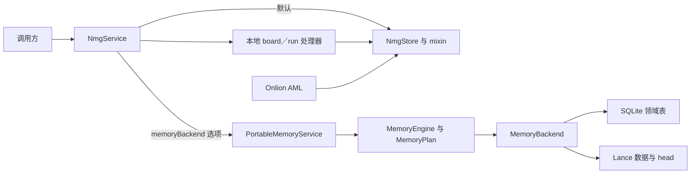

# 依赖边界与两条记忆路径——2026-11-14

[English](architecture-dependency-and-memory-2026-11-14.md) · [术语](architecture-dependency-and-memory-2026-11-14.terms.yaml)

本次测量针对版本 `aa125ae541ae69999bea79b0c9552de520874f81`，环境为 Windows、Node `v26.13.0`，是对历史[架构基线](architecture-baseline-2026-10-27.zh-CN.md)的补充。这里记录源码观察和选定测试结果，不建立新的依赖规则，也不证明两条记忆路径已达到生产功能等价。已接受的方向归[统一架构](../design/unified-architecture.zh-CN.md)所有。

## 依赖矩阵

[可复测脚本](architecture-import-matrix-2026-11-14.mjs)于 2026-11-14 12:24:26 UTC 扫描了 **192 个 `src/` 下受 Git 跟踪的 TypeScript 文件**，得到 **194 条跨组相对引用**。行是引用方，列是被引用方。数字统计源码声明／调用，不是不同目标文件数：两条声明引用同一模块计两次。`—` 表示不统计组内引用；`0` 表示按此口径未发现。

| 引用方／目标 | core | integration | cli | lab | rcp | prompts |
| --- | ---: | ---: | ---: | ---: | ---: | ---: |
| core | — | 3 | 0 | 1 | 0 | 0 |
| integration | 63 | — | 9 | 4 | 0 | 2 |
| cli | 33 | 22 | — | 5 | 0 | 0 |
| lab | 9 | 0 | 0 | — | 0 | 0 |
| rcp | 0 | 0 | 0 | 0 | — | 0 |
| prompts | 0 | 0 | 0 | 0 | 0 | — |
| `src/index.ts` | 18 | 24 | 1 | 0 | 0 | 0 |

脚本复用既有 TypeScript 引用提取器，并补充 `import("...")` 类型查询。它统计字符串字面量的 import／export、import-equals、`require()` 和动态 import，包含纯类型引用；不递归追踪依赖，也不区分启动时加载与运行时实际经过的代码。所扫语法中未发现计算得到的路径。相对路径按解析结果归组，但不验证目标文件是否存在。包引用、别名、未跟踪的生成文件、JavaScript（包括 `src/cli/graph/assets/graph.js`）、测试，以及作为引用方的宿主适配器、`onlion/`、`evals/` 不在矩阵范围内。尤其 `rcp` 行不能证明 RCP 没有外部或运行时依赖。

在仓库依赖可用的检出目录运行：

```sh
node --experimental-strip-types docs/experiments/architecture-import-matrix-2026-11-14.mjs --root .
```

输出 JSON 包含版本、时间、文件与引用总数、计算路径提示和完整引用清单。`src/` 有未提交改动时脚本拒绝测量；比较时也应固定脚本及共享提取器版本。它复用[验证影响探针](../../scripts/verification-impact-probe.ts)的 `moduleSpecifiers`，再以 AST 遍历补充该提取器未包含的类型查询；结果不证明测试充分。

## 边界观察

- `core → integration` 有三条运行时声明：[active-graph.ts](../../src/core/store/active-graph.ts) 引用 `SOURCE_EXCERPT_CHARS`；[base.ts](../../src/core/store/base.ts) 引用任务单元声明操作和类型；[schema.ts](../../src/core/store/schema.ts) 引用对应 schema。后两条指向同一任务单元模块。
- `core → lab` 是一条运行时声明：[hierarchical-activation.ts](../../src/core/hierarchical-activation.ts) 引用 autodiff。源码依赖不证明 Lab 已激活，也不证明默认调用失败。
- `integration → cli` 是五个文件中的九条声明：四条携带运行时值，五条是 `import type`。运行时值分别是 `resolveNmgDataDir`、`NMG_PROTOCOL_VERSION`、`assertDaemonProtocol` 和 `requiresEventTimeReference`，见 [agent-identity.ts](../../src/integration/agent-identity.ts)、[harness-connection.ts](../../src/integration/harness-connection.ts) 和 [lease-transport.ts](../../src/integration/lease-transport.ts)。纯类型引用出现在后两个文件、[mcp-tools.ts](../../src/integration/mcp-tools.ts) 和 [state.ts](../../src/integration/state.ts)。
- `integration → lab` 有四条声明：三条携带运行时值，一条为纯类型。`cli → lab` 有五条声明。两者都包含可选功能或纯类型引用，不能当作默认路径实际加载量。
- [CLI main](../../src/cli/main.ts) 为启动路径导入服务和 HTTP 服务端实现。未来为客户端设依赖规则时须区分负责组装和启动的入口与薄客户端；此观察不决定新的目录布局。

## 两条记忆路径



| 职责 | 默认 `NmgStore` 路径 | 显式启用的可替换路径 |
| --- | --- | --- |
| 选择与 API | 不设置 `memoryBackend`；[服务分发](../../src/cli/service.ts)调用既有 `#remember`、`#search`、`#get` 等方法。 | 显式设置 `memoryBackend`；[PortableMemoryService](../../src/cli/portable-memory.ts)处理 `remember`、`rememberBatch`、`search`、`get`、`deleteMemory`，拒绝其他非本地方法。`MemoryEngine.linkNodes` 是库方法，此配置没有将它暴露为服务方法。 |
| 含义与写入 | 服务负责写入策略准入和拒绝记录，再由 Store 的 mixin 链写入。[NmgStore](../../src/core/store.ts)组合 coordination、graph、analogy、community、retrieval、writes 和 maintenance。 | [model.ts](../../src/core/memory/model.ts)、[plan.ts](../../src/core/memory/plan.ts)、[engine.ts](../../src/core/memory/engine.ts)验证输入、规划实体，再通过异步端口提交。稳定操作 ID 支持凭据重放。 |
| 共享基础函数 | 旧路径使用 `assessMemoryWrite`、时间与 claim 辅助函数、Store 排序和行处理工具。 | 新路径也使用其中部分函数，包括 `assessMemoryWrite`、claim、时间校验、marker 归一化和语句归一化。调用位置的准入输入和拒绝写入记账不同；本次未证明行为等价。 |
| 存储与协作 | `NmgStoreBase` 拥有 SQLite 连接及 board／run 协调事务。项目 STG 使用项目存储与会话范围行，LTG 使用服务存储。 | SQLite 使用 `nmg_memory_head`、`nmg_memory_entities`、`nmg_memory_fts`；默认与本地 board／run 表共用服务 SQLite 文件，但记忆后端与协作分别拥有连接和事务。Lance 在暂存分支保存实体与凭据，再有条件发布 head。 |
| 检索与高级功能 | 服务协调既有 Store／integration 检索、AG／会话能力和其他协议方法。 | 检索使用后端词法检索与有界图扩展。此配置不暴露 AG、chain、tesserae、向量检索和高级过滤；能力握手和明确拒绝界定实际子集。 |
| 云端路径 | [Onlion AML](../../onlion/backend/memory-service.ts)使用 `NmgStore` 和共享检索；其 Worker 使用 SQLite WASM 与对象快照。 | 原生 Lance 驱动可使用 S3 URI。它是独立的显式实现，不是现有 AML 快照路径；本次未证明 Worker 部署或真实 S3 服务商可用。 |

共用本地 SQLite 文件不会使独立的记忆和黑板操作自动成为一个事务。可替换格式不会自动导入或同步旧记录，选择新配置不能视为透明切换。领域端口统一的是可替换后端；旧路径和新路径仍有各自的写入与检索编排。仅凭矩阵不能判断二者的行为漂移，也不能证明移动 mixin 后行为不变。

矩阵还将两套实现都归入 `core`，因此看不到可替换路径的 [model.ts](../../src/core/memory/model.ts) 引用 `store/rows.ts`，以及 [plan.ts](../../src/core/memory/plan.ts) 和 `entity-rows.ts` 引用 `store/search-ranking.ts`。这些是对归一化辅助函数的源码依赖，不代表原生 Lance 后端会打开 SQLite。把新引擎视为独立于旧 Store 实现前，需要审查这些函数的归属。

## 选定验证

为干净工作树生成所需的已忽略提示词源码后，以下命令在一次本地运行中通过 **31/31 项测试**：

```sh
node --experimental-strip-types --test tests/core/memory-backend.test.ts tests/core/memory-engine.test.ts tests/core/memory-s3.test.ts tests/cli/portable-memory.test.ts tests/core/store/writes.test.ts
```

首次运行缺少 `src/prompts/nmg-prompts.generated.ts`，导致两个测试文件无法加载；`npm run prompts:generate` 解决了该环境准备问题。依赖由父检出目录的安装解析。S3 测试使用 Lance HTTP 驱动和进程内对象协议夹具，不是真实 AWS。测试只覆盖选定不变量，不证明完整功能等价、迁移、服务商持久性、性能或全部宿主集成。探针夹具与既有影响探针测试也通过（7/7）。

改变依赖规则或替换 mixin 前，应以同一组案例比较两条应用路径的写入准入与审计、去重与替换、证据与可见性、图遍历、事务回滚、检索选项、AG 披露和本地黑板协作。把不支持的功能与行为不一致分别记录。本次没有执行这样的完整等价比较，也没有迁移数据。
