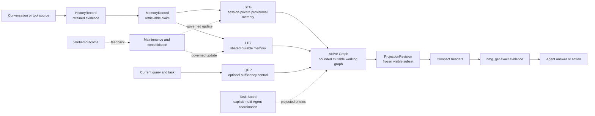

# NMG concept map

[中文](concept-map.zh-CN.md) · [Terms used](concept-map.terms.yaml)

This page is a learning and navigation aid, not a second specification. It gives
each major concept one operational meaning and links to the document that owns
the full contract. When this map and an owner disagree, the owner wins.

## The system in one picture



The shortest useful reading is: NMG preserves evidence, organizes claims in STG
and LTG, maintains a bounded session AG and exposes frozen retrieval projections.
Search returns a compact directory; `get` opens selected exact evidence.

## Core concepts

| Concept | Operational meaning | Why it exists | Contract owner |
| --- | --- | --- | --- |
| `HistoryRecord` | Retained source evidence and provenance | A semantic summary must remain checkable | [Core data model](../design/design/core-data-model.md) |
| `MemoryRecord` | One retrievable, scoped claim derived from evidence | Retrieval needs a smaller unit than a transcript | [Core data model](../design/design/core-data-model.md) |
| `MemoryNode` | A stable semantic address grouping related records | Records need local organization without losing their IDs | [Core data model](../design/design/core-data-model.md) |
| STG | Session-private graph for provisional or current-task meaning | New information must be useful before long-term structure is trusted | [Provisional STG](../design/memory-graphs.md#stg-provisional-memory) |
| LTG | Shared persistent graph for durable memory and consolidated structure | Long-running Agents need reusable state beyond one session | [Durable LTG](../design/memory-graphs.md#ltg-durable-memory) |
| Active Graph (AG) | Bounded mutable session working graph over memory references and temporary state | Working context changes without becoming shared truth | [AG runtime and projections](../design/memory-graphs/session-runtime-graph-and-projection-revisions.md) |
| Projection revision | Immutable visible subset frozen from AG | Retrieval and feedback need a stable selection/provenance boundary | [Projection owner](../design/memory-graphs/session-runtime-graph-and-projection-revisions.md) |
| `activeGraphId` | The stable ID of one retrieval projection, passed from `search` to `get` | Exact disclosure must be budgeted, session-owned, and attributable to its search | [Projection identity](../design/memory-graphs/session-runtime-graph-and-projection-revisions.md#disclosure-and-attribution) |
| QPP | Optional prediction of whether retrieval is broad and complete enough | Progressive recall needs a reason to stop, expand, or fold noise | [retrieval confidence controller](../design/retrieval-confidence-controller.md) |
| Memory chain | A bounded ordered view over existing memory IDs | Some tasks need event order or explicit dependencies without copying evidence | [Static temporal and logical memory chains](../design/design/active-graph-activation-and-consolidation.md#static-temporal-and-logical-memory-chains) |
| Task Board | Attributed, expiring, task-scoped Agent coordination outside semantic memory | Private AGs cannot communicate directly across Agents | [memory-graphs.md Shared Task Board (cross-Agent coordination, not a memory graph)](../design/memory-graphs/session-runtime-graph-and-projection-revisions/shared-task-board.md#shared-task-board-cross-agent-coordination-not-a-memory-graph-1) |
| Protocol-governed collaboration | Agents coordinate through a published protocol, while the mechanics and the deciding stay with the program | Coordination needs a name that separates who discusses from who decides | [Name the collaboration protocol](../decisions/implemented/2026-09-20-name-the-collaboration-protocol.md) |
| Task-Unit Protocol | A task is declared as a unit and adopted into one run, where it is claimed, delivered and independently judged | The board alone cannot say what a unit's inputs, dependencies and acceptance are | [task-unit-semantics.md](../design/task-unit-semantics.md) |
| Maintenance and consolidation | Deterministic index work plus evidence-gated semantic promotion or topology proposals | Write cost must stay bounded and repeated use must not manufacture truth | [Incremental storage and index maintenance](../design/design/incremental-storage-and-index-maintenance.md#incremental-storage-and-index-maintenance-1) |
| Learnable controller | An optional numeric policy over hard-bounded allocation, fold, and rerank decisions | Natural outcome evidence may improve control without making memory graphs differentiable | [Learnable routing and minimal differentiable query graphs](../design/design/learnable-routing-and-differentiable-query-graphs.md#learnable-routing-and-differentiable-query-graphs-1) |
| Lab | Explicitly leased optional capabilities such as reasoning workspace and graph reasoner | Experimental mechanisms must be usable without silently becoming defaults | [Session reasoning workspace and compaction checkpoint](../design/design/session-reasoning-workspace-and-compaction-checkpoint.md#session-reasoning-workspace-and-compaction-checkpoint-1) |

STG, LTG, and AG are not three equivalent databases. STG and LTG are physical
semantic residence layers. AG is a memory-resident session working graph;
a projection freezes a budgeted selection, not the whole live graph.

## First recall, as an algorithm

```text
saved = remember(statement, node, type, scope)
directory = search(query, scope)
selectedIds = agent_select(directory.candidate_headers)
evidence = get(selectedIds, activeGraphId=directory.activeGraphId)
answer_from(evidence)
```

The invariants are more important than the syntax:

1. `remember` admits a scoped semantic claim; it does not copy an entire session.
2. `search` is allowed to return no useful candidate.
3. Search headers are lossy routing hints, not answer evidence.
4. `get` is the lossless disclosure step and should reuse the same
   `activeGraphId` when one was returned.
5. Retrieval, disclosure, and answer overlap do not prove usefulness. Only an
   attributable verified outcome may supervise consolidation or learning.

Run the isolated walkthrough in the [first-recall tutorial](first-recall.md).

## Where to go next

- To use the product, follow [the first-recall tutorial](first-recall.md), then
  inspect `nmg remember --help`, `nmg search --help`, and `nmg get --help`.
- To change architecture, begin with [the normative design](../design/design.md)
  and follow the owner links above.
- To understand current implementation evidence, use
  [completion-audit.md](../design/completion-audit.md).
- To change an Agent workflow, use the relevant repository Skill rather than
  copying operational rules into this map.
