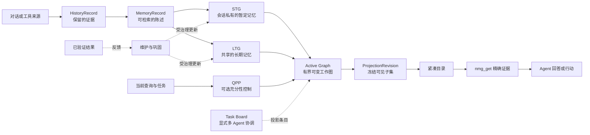

# NMG 概念地图

[English](concept-map.md) · [术语](concept-map.terms.yaml)

本页只用于学习和导航，不是第二份规范。它为主要概念提供一句可操作的含义，并链接到拥有完整契约的文档。若本页与 owner 文档冲突，以 owner 为准。

## 一张图理解系统



最短的理解方式是：NMG 保留证据，把陈述组织进 STG 和 LTG，维护有界会话 AG，并暴露冻结检索投影。`search` 返回紧凑目录，`get` 打开选中的精确证据。

## 核心概念

| 概念 | 可操作含义 | 为什么存在 | 契约 owner |
| --- | --- | --- | --- |
| `HistoryRecord` | 被保留的来源证据与 provenance | 语义摘要必须可以核验 | [核心数据模型](../design/design/core-data-model.md) |
| `MemoryRecord` | 从证据提取的一条可检索、有作用域的陈述 | 检索单位应小于整段会话 | [核心数据模型](../design/design/core-data-model.md) |
| `MemoryNode` | 聚合相关记录的稳定语义地址 | 在不破坏记录 ID 的前提下局部组织记忆 | [核心数据模型](../design/design/core-data-model.md) |
| STG | 保存暂定含义和当前任务信息的会话私有图 | 新信息应先可用，再决定是否相信其长期结构 | [暂定 STG](../design/memory-graphs.zh-CN.md#stg暂定记忆) |
| LTG | 保存长期记忆和已巩固结构的共享持久图 | 长期 Agent 需要跨会话复用状态 | [持久 LTG](../design/memory-graphs.zh-CN.md#ltg持久记忆) |
| Active Graph（AG） | 围绕记忆引用和临时状态的有界可变会话工作图 | 工作上下文可以变化，不成为共享真值 | [AG 运行时与投影](../design/memory-graphs/session-runtime-graph-and-projection-revisions.zh-CN.md) |
| 投影修订 | 从 AG 冻结的不可变可见子集 | 检索与反馈需要稳定的选择／来源边界 | [投影 owner](../design/memory-graphs/session-runtime-graph-and-projection-revisions.zh-CN.md) |
| `activeGraphId` | 一次检索投影的稳定 ID，由 `search` 传给 `get` | 精确披露需要受预算、会话所有权和检索归因约束 | [投影身份](../design/memory-graphs/session-runtime-graph-and-projection-revisions.zh-CN.md#披露与归因) |
| QPP | 可选的检索广度与充分性预测 | 渐进式回忆需要决定停止、扩展或折叠噪声 | [检索充分性与控制器边界](../design/retrieval-confidence-controller.zh-CN.md) |
| Memory chain | 对现有 memory ID 的有界有序视图 | 时间顺序和显式依赖不应复制证据 | [静态时间与逻辑记忆链](../design/design/active-graph-activation-and-consolidation.md#static-temporal-and-logical-memory-chains) |
| Task Board | 位于语义记忆之外、有归因、有过期时间的任务级协作区 | 私有 AG 不能直接完成跨 Agent 通讯 | [memory-graphs.md Shared Task Board (cross-Agent coordination, not a memory graph)](../design/memory-graphs/session-runtime-graph-and-projection-revisions/shared-task-board.md#shared-task-board-cross-agent-coordination-not-a-memory-graph-1) |
| 协议化协作 | agent 通过一份公开协议协商，机制与拍板留在程序侧 | 协作需要一个把“谁讨论、谁拍板”分开的名字 | [命名决策](../decisions/implemented/2026-09-20-name-the-collaboration-protocol.zh-CN.md) |
| 任务单元协议 | 任务被声明为单元并收编进一次 run，在其中被认领、交付与独立裁决 | 黑板自己说不清一个单元的输入、依赖与验收是什么 | [task-unit-semantics.md](../design/task-unit-semantics.md) |
| 维护与巩固 | 确定性索引维护，加上有证据门控的语义晋升或拓扑 proposal | 写入成本必须有界，重复检索不能制造“事实” | [增量存储与索引维护](../design/design/incremental-storage-and-index-maintenance.md#incremental-storage-and-index-maintenance-1) |
| 可学习控制器 | 在硬预算内可选地学习 allocate、fold 和 rerank 的数值策略 | 可利用自然结果改进控制，但无需让记忆图本身可微 | [可学习路由与最小可微查询图](../design/design/learnable-routing-and-differentiable-query-graphs.md#learnable-routing-and-minimal-differentiable-query-graphs-1) |
| Lab | 通过显式 lease 使用的 reasoning workspace、graph reasoner 等可选能力 | 实验机制可以被使用，但不能静默成为默认行为 | [会话推理工作区与压缩检查点](../design/design/session-reasoning-workspace-and-compaction-checkpoint.md#session-reasoning-workspace-and-compaction-checkpoint-1) |

STG、LTG、AG 不是三份同类数据库。STG 和 LTG 是语义驻留层；AG 是驻内存的会话工作图，投影冻结有预算的选择，不等于整个活图。

## 第一次回忆的算法

```text
saved = remember(statement, node, type, scope)
directory = search(query, scope)
selectedIds = agent_select(directory.candidate_headers)
evidence = get(selectedIds, activeGraphId=directory.activeGraphId)
answer_from(evidence)
```

比语法更重要的是这些不变量：

1. `remember` 接纳一条有作用域的语义陈述，而不是复制整场会话。
2. `search` 可以明确返回“没有有用候选”。
3. 搜索目录是有损路由提示，不是回答证据。
4. `get` 才是无损披露步骤；若 `search` 返回了 `activeGraphId`，应继续传入。
5. 被检索、被披露或与回答文字重叠都不等于有用；只有可归因的已验证结果才能监督巩固或学习。

可以直接运行[第一次回忆教程](first-recall.zh-CN.md)。

## 接下来读什么

- 想使用产品：先跑[第一次回忆教程](first-recall.zh-CN.md)，再查看 `nmg remember --help`、`nmg search --help` 和 `nmg get --help`。
- 想修改架构：从[规范设计](../design/design.md)开始，并沿上表 owner 链接阅读。
- 想确认当前实现证据：查看 [completion-audit.md](../design/completion-audit.md)。
- 想修改 Agent 工作流：使用对应仓库 Skill，不要把操作规则复制进本页。
